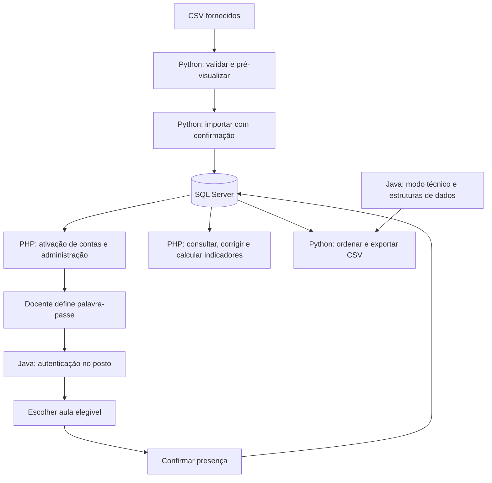
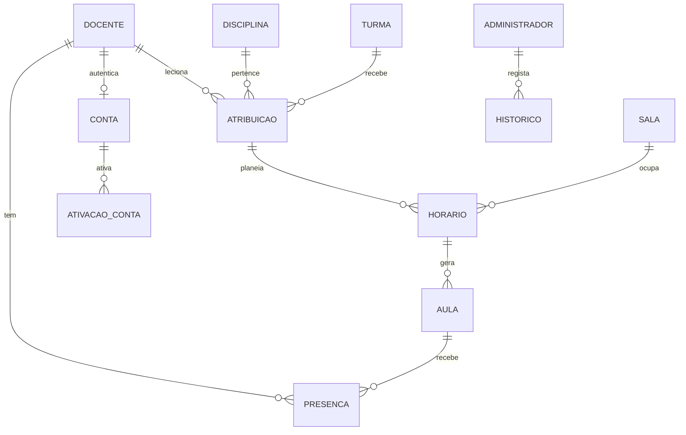

# Guião passo a passo — Trabalho Prático de LTC 2026/2027

> **Projeto:** Sistema de Gestão de Presenças de Docentes  
> **Unidade curricular:** Linguagens e Teoria da Computação  
> **Entrega:** 14 de janeiro de 2027, até às 23h59 (hora de Portugal continental)  
> **Versão deste guião:** 9 de novembro de 2026  
> **Ambiente assumido:** Windows 10/11, 64 bits.

Este documento foi preparado para orientar o desenvolvimento desde um computador sem ferramentas instaladas até à entrega do ZIP e à defesa. Segue o enunciado do trabalho como referência. As escolhas de versões, programas auxiliares, organização das pastas e sequência operacional identificadas como **recomendação** são sugestões práticas para facilitar o desenvolvimento; não são requisitos adicionais impostos pelo docente.

---

## Índice

1. [O que vais construir](#1-o-que-vais-construir)
2. [O que o enunciado exige](#2-o-que-o-enunciado-exige)
3. [Plano de instalações](#3-plano-de-instalações)
4. [Instalar e configurar tudo no Windows](#4-instalar-e-configurar-tudo-no-windows)
5. [Criar o projeto e o repositório GitHub](#5-criar-o-projeto-e-o-repositório-github)
6. [Preparar os ficheiros de apoio](#6-preparar-os-ficheiros-de-apoio)
7. [Desenhar a arquitetura e o modelo de dados](#7-desenhar-a-arquitetura-e-o-modelo-de-dados)
8. [Etapa 1 — Criar a base de dados SQL Server](#8-etapa-1--criar-a-base-de-dados-sql-server)
9. [Etapa 2 — Implementar importação e validação em Python](#9-etapa-2--implementar-importação-e-validação-em-python)
10. [Etapa 3 — Implementar ativação de contas em PHP](#10-etapa-3--implementar-ativação-de-contas-em-php)
11. [Etapa 4 — Implementar o posto de presenças em Java](#11-etapa-4--implementar-o-posto-de-presenças-em-java)
12. [Etapa 5 — Implementar algoritmos e estruturas em Java](#12-etapa-5--implementar-algoritmos-e-estruturas-em-java)
13. [Etapa 6 — Implementar o portal administrativo PHP](#13-etapa-6--implementar-o-portal-administrativo-php)
14. [Etapa 7 — Implementar exportação em Python](#14-etapa-7--implementar-exportação-em-python)
15. [Etapa 8 — Testes e medições](#15-etapa-8--testes-e-medições)
16. [Etapa 9 — Relatório](#16-etapa-9--relatório)
17. [Etapa 10 — Empacotar e entregar](#17-etapa-10--empacotar-e-entregar)
18. [Guião da demonstração e defesa](#18-guião-da-demonstração-e-defesa)
19. [Calendário de trabalho](#19-calendário-de-trabalho)
20. [Divisão do trabalho em grupo](#20-divisão-do-trabalho-em-grupo)
21. [Problemas comuns e como os resolver](#21-problemas-comuns-e-como-os-resolver)
22. [Checklist final](#22-checklist-final)
23. [Ligações oficiais e documentação](#23-ligações-oficiais-e-documentação)

---

# 1. O que vais construir

Vais desenvolver um sistema local para registar a presença de docentes nas aulas. O docente utiliza uma aplicação Java no posto junto da segurança. A administração utiliza um portal PHP. Python trata da entrada e saída de dados em CSV. SQL Server guarda os dados de todas as componentes.

O funcionamento geral é:



As quatro componentes devem utilizar a **mesma base de dados**. Não construas quatro aplicações independentes com cópias diferentes dos dados.

## 1.1 O que não precisas de construir

O enunciado limita o âmbito à presença de docentes. Não exige gestão de estudantes, salários, reconhecimento facial, localização, aplicação móvel ou publicação na Internet. Não gastes tempo nestas funcionalidades.

## 1.2 Estratégia recomendada

Trabalha nesta ordem:

1. Instalar as ferramentas.
2. Obter e analisar os CSV de apoio.
3. Definir o modelo de dados e os formatos comuns.
4. Criar SQL Server e testar a ligação das três linguagens.
5. Desenvolver Python para carregar os dados base.
6. Desenvolver a ativação de contas em PHP.
7. Desenvolver o posto de presenças em Java.
8. Implementar as estruturas e algoritmos de Java.
9. Completar a administração em PHP.
10. Desenvolver a exportação Python.
11. Testar tudo, medir algoritmos, escrever relatório e preparar a entrega.

Depois de o grupo acordar o modelo de dados e os formatos de intercâmbio, partes de Java, PHP e Python podem ser desenvolvidas em paralelo.

---

# 2. O que o enunciado exige

## 2.1 Componentes obrigatórias

| Componente | Responsabilidade |
|---|---|
| Java | Posto de registo de presenças e modo técnico para aplicar pesquisas, ordenações e estruturas próprias. |
| PHP | Portal administrativo, gestão de dados, ativação/reposição de palavras-passe e correio eletrónico simulado. |
| Python | Validação, pré-visualização, importação e exportação CSV com algoritmos próprios. |
| SQL Server | Persistência, chaves, integridade e transações. |

## 2.2 Dados de base

Os sete CSV de `Dados_Base` devem originar estes totais depois da importação:

| Ficheiro | Total esperado |
|---|---:|
| `docentes.csv` | 12 |
| `disciplinas.csv` | 6 |
| `turmas.csv` | 4 |
| `salas.csv` | 4 |
| `atribuicoes.csv` | 12 |
| `horarios.csv` | 24 |
| `aulas.csv` | 388 |

Os dados de aulas abrangem 9 de novembro de 2026 a 1 de março de 2027. O calendário é fictício.

## 2.3 Regras de dados importantes

- Número mecanográfico: texto com exatamente seis algarismos; não o guardar como inteiro, para preservar zeros iniciais.
- Emails: obrigatórios, únicos, sem espaços e com domínio `ispgaya.pt`; normalizar para minúsculas.
- Códigos: 1 a 20 caracteres, apenas letras ASCII, números, hífen ou sublinhado; normalizar para maiúsculas.
- `ativo`: 0 ou 1.
- Ano: 1 a 3; semestre: 1 ou 2; capacidade: inteiro positivo.
- Datas: `YYYY-MM-DD`; horas: `HH:MM`.
- A hora inicial tem de ser anterior à hora final, no mesmo dia.
- Dia semanal: 1 = segunda-feira até 7 = domingo.
- O período de vigência é inclusivo e tem de conter uma ocorrência do dia semanal.
- O ano da turma tem de coincidir com o ano da disciplina.
- Uma aula referencia um horário e uma data compatíveis com o dia semanal e o período de vigência.
- Uma ocorrência é única pelo par horário–data.
- Uma presença é única por docente–aula e tem de corresponder ao docente responsável.
- Instantes de registo guardados em UTC; apresentação em `Europe/Lisbon`.
- Java e PHP devem utilizar o instante do SQL Server para as verificações temporais.

## 2.4 O que não podes delegar ao SQL

O enunciado permite `SELECT`, `WHERE`, `JOIN`, `INSERT`, `UPDATE`, `DELETE`, índices de integridade e transações. Porém, as pesquisas, ordenações, cálculos de indicadores e regras de negócio que são avaliados devem ser executados no código, em memória.

Não uses como substitutos:

- `ORDER BY` para fazer as ordenações avaliadas;
- `GROUP BY`, `DISTINCT`, agregações ou funções de ranking para calcular os indicadores;
- triggers ou procedimentos SQL para esconder regras de negócio que devem estar nas aplicações;
- resultados de `SELECT` como se viessem numa ordem garantida.

Usa sempre consultas parametrizadas. Não guardes credenciais reais no repositório.

---

# 3. Plano de instalações

## 3.1 Computador recomendado

O enunciado não define os requisitos mínimos do computador. Para trabalhar confortavelmente, recomenda-se:

- Windows 10 ou 11 de 64 bits;
- pelo menos 8 GB de RAM (16 GB é preferível para SQL Server e IDE em simultâneo);
- espaço livre suficiente para SQL Server, ferramentas e ficheiros de apoio;
- ligação à Internet para descarregar instaladores e dependências.

## 3.2 Programas a instalar

As versões abaixo são uma combinação recomendada consultada em 9 de novembro de 2026. Não são versões impostas pelo enunciado. Mantém a mesma combinação em todos os computadores do grupo sempre que possível.

| Programa | Para que serve | Escolha recomendada | Obrigatório? |
|---|---|---|---|
| Visual Studio Code | Editor para Java, PHP, Python, SQL e Markdown | Versão estável x64 | Recomendado |
| Git for Windows | Versionamento e ligação ao GitHub | Versão estável x64 | Recomendado para trabalho em grupo |
| JDK | Compilar e executar Java | Eclipse Temurin JDK 25 LTS x64 | Sim, para Java |
| Apache Maven | Construir o projeto Java e gerir dependências | Maven 3.10.0 ou Maven Wrapper no projeto | Recomendado |
| Python | Executar importação, exportação e testes | Python 3.13.x x64 | Sim, para Python |
| PHP | Executar o portal administrativo | PHP 8.5 x64 NTS | Sim, para PHP |
| Visual C++ Redistributable | Bibliotecas necessárias para builds PHP no Windows | Visual C++ 2015–2022 x64 | Necessário conforme o build PHP |
| SQL Server | Motor da base de dados | SQL Server 2025 Developer (uso de desenvolvimento) | Sim |
| SSMS | Criar, consultar e administrar a base de dados | SQL Server Management Studio 22 | Muito recomendado |
| ODBC Driver | Permitir acesso ao SQL Server por drivers de cliente, incluindo PHP e Python | Microsoft ODBC Driver 18 x64 | Sim para a configuração proposta |
| Conta GitHub | Alojar o repositório do grupo | Repositório privado no início | Recomendado |
| diagrams.net | Desenhar o modelo relacional e diagramas | Aplicação web ou desktop | Recomendado |

**Não precisas de instalar:** Node.js, XAMPP, WAMP, Docker, Composer ou JavaFX para a implementação mínima proposta neste guião. Só os instales se o grupo escolher conscientemente uma arquitetura que deles necessite. O servidor PHP integrado é suficiente para desenvolvimento local; não é um servidor de produção.

## 3.3 Dependências que serão instaladas dentro dos projetos

- Java: Microsoft JDBC Driver for SQL Server através do Maven.
- PHP: `sqlsrv` e `pdo_sqlsrv` através do PHP Installer for Extensions (PIE).
- Python: `pyodbc`, `python-dotenv` e `pytest` através do `pip`.

---

# 4. Instalar e configurar tudo no Windows

Segue a ordem. Depois de cada instalação, fecha e volta a abrir o terminal para atualizar o `PATH`.

## 4.1 Atualizar o Windows e confirmar a arquitetura

1. Abre **Definições → Sistema → Acerca de**.
2. Confirma que o sistema é Windows 10/11 e que o tipo de sistema é de 64 bits.
3. Instala as atualizações pendentes do Windows.
4. Cria uma pasta de trabalho, por exemplo `C:\Projetos`.

## 4.2 Instalar o Visual Studio Code

1. Abre [https://code.visualstudio.com/download](https://code.visualstudio.com/download).
2. Descarrega o instalador Windows x64.
3. Executa o instalador.
4. Aceita a licença.
5. Recomenda-se ativar as opções para adicionar `code` ao PATH e abrir pastas com o VS Code no menu de contexto.
6. Termina a instalação.
7. Abre o VS Code uma vez.

### Extensões a instalar no VS Code

Abre a secção **Extensions** (`Ctrl+Shift+X`) e instala:

| Extensão | Utilização |
|---|---|
| Extension Pack for Java (Microsoft) | Java, depuração, testes e Maven |
| PHP Intelephense | Sugestões e análise de PHP |
| Python (Microsoft) | Execução e depuração Python |
| Pylance (Microsoft) | Análise de código Python |
| MSSQL (Microsoft) | Consultar SQL Server no VS Code |
| GitLens (opcional) | Consultar histórico Git |
| Markdown All in One (opcional) | Escrever o README e documentação |

Não instales extensões aleatórias para resolver problemas sem perceber o que fazem.

## 4.3 Instalar Git for Windows

1. Abre [https://git-scm.com/install/win](https://git-scm.com/install/win).
2. Descarrega o instalador x64.
3. Executa-o e mantém as opções recomendadas, incluindo Git disponível no terminal e integração com o menu de contexto.
4. Abre **PowerShell** e executa:

```powershell
git --version
```

5. Define o nome e email que queres associar aos commits:

```powershell
git config --global user.name "O Teu Nome"
git config --global user.email "o-teu-email@example.com"
```

Usa o email associado à tua conta GitHub, se quiseres que os commits fiquem ligados à conta.

## 4.4 Instalar Java JDK 25

O JDK inclui o compilador (`javac`) e a máquina virtual Java. Não instales apenas um JRE.

1. Abre [https://adoptium.net/temurin/releases/](https://adoptium.net/temurin/releases/).
2. Escolhe versão **25 LTS**, sistema **Windows**, arquitetura **x64**, pacote **JDK** e instalador **MSI**.
3. Executa o instalador.
4. Quando as opções forem apresentadas, ativa as opções para definir `JAVA_HOME` e acrescentar Java ao `PATH`, se estiverem disponíveis.
5. Termina a instalação.
6. Fecha e reabre o PowerShell.
7. Executa:

```powershell
java -version
javac -version
$env:JAVA_HOME
```

Deves conseguir ver a versão 25 e um caminho de instalação do JDK. Se `javac` não for reconhecido, verifica `JAVA_HOME` e o `PATH` nas variáveis de ambiente do Windows.

## 4.5 Instalar Apache Maven

Maven gere dependências e compila o projeto Java. O driver JDBC será descarregado automaticamente pelo Maven.

1. Abre [https://maven.apache.org/download.cgi](https://maven.apache.org/download.cgi).
2. Descarrega o arquivo **Binary zip archive** da versão estável recomendada (3.10.0 à data deste guião).
3. Extrai para uma localização simples, por exemplo `C:\Tools\apache-maven-3.10.0`.
4. Nas variáveis de ambiente do Windows, cria `MAVEN_HOME` com esse caminho.
5. Acrescenta `%MAVEN_HOME%\bin` ao `Path` do utilizador.
6. Fecha e reabre PowerShell.
7. Executa:

```powershell
mvn -version
```

Deve indicar a versão do Maven e o Java 25. Como alternativa, o grupo pode usar o **Maven Wrapper** (`mvnw.cmd`) incluído no repositório. Nesse caso, todos devem compilar usando o wrapper para manter a versão consistente.

## 4.6 Instalar Python

Para reduzir problemas de compatibilidade de bibliotecas, este guião recomenda Python 3.13.x em vez de instalar imediatamente a versão mais recente de desenvolvimento da linguagem.

1. Abre [https://www.python.org/downloads/windows/](https://www.python.org/downloads/windows/).
2. Escolhe a versão estável 3.13.x e o instalador **Windows installer (64-bit)**.
3. Executa o instalador.
4. Na primeira janela, ativa **Add python.exe to PATH**.
5. Escolhe a instalação para o utilizador atual ou para todos os utilizadores, conforme as permissões do computador.
6. Termina a instalação.
7. Abre um PowerShell novo e executa:

```powershell
py -3.13 --version
python --version
python -m pip --version
```

Se `python` abrir a Microsoft Store, corrige os aliases em **Definições → Aplicações → Definições avançadas de aplicações → Aliases de execução de aplicações**, ou usa `py -3.13`.

## 4.7 Instalar SQL Server 2025 Developer

A edição Developer é indicada para desenvolvimento e testes. Não deve ser utilizada como edição de produção.

1. Abre [https://www.microsoft.com/en-us/sql-server/sql-server-downloads](https://www.microsoft.com/en-us/sql-server/sql-server-downloads).
2. Seleciona SQL Server 2025 e a edição **Developer** gratuita.
3. Descarrega o instalador e inicia a instalação.
4. Escolhe instalação personalizada ou a opção que permita controlar as funcionalidades.
5. Seleciona, no mínimo, **Database Engine Services**.
6. Para simplificar a ligação entre linguagens, recomenda-se uma instância predefinida (`MSSQLSERVER`). Se já existir uma instância, regista o nome exato para o utilizar nas ligações.
7. Na configuração do serviço, mantém uma conta de serviço gerida pelo instalador, salvo orientação técnica diferente.
8. Na configuração de autenticação, escolhe **Mixed Mode (SQL Server authentication and Windows authentication)** se o grupo decidir utilizar um login SQL comum às três linguagens.
9. Define uma palavra-passe forte para a conta administrativa `sa` e guarda-a fora do GitHub. Não uses `sa` nas aplicações.
10. Acrescenta a tua conta Windows como administrador do SQL Server, se o instalador oferecer essa opção.
11. Conclui a instalação.
12. Abre o **SQL Server Configuration Manager** e verifica se o serviço SQL Server está em execução.

### Configurar TCP/IP para desenvolvimento local

A ligação proposta usa o SQL Server na própria máquina. Se escolheres TCP/IP:

1. Abre SQL Server Configuration Manager.
2. Vai a **SQL Server Network Configuration → Protocols for MSSQLSERVER** (ou à tua instância).
3. Ativa **TCP/IP**.
4. Nas propriedades de TCP/IP, abre **IP Addresses**.
5. Define a porta TCP estática `1433` em `IPAll → TCP Port` e limpa `TCP Dynamic Ports`, se estiver preenchido.
6. Reinicia o serviço SQL Server.
7. Mantém a porta acessível apenas localmente durante o desenvolvimento; não abras a base de dados à Internet.

Se utilizares uma instância nomeada como `SQLEXPRESS`, a ligação pode ser `localhost\SQLEXPRESS`, e a configuração de porta/SQL Browser pode ser diferente. Regista a decisão no `INSTRUCOES.txt`.

## 4.8 Instalar SQL Server Management Studio 22

1. Abre [a página oficial de instalação do SSMS](https://learn.microsoft.com/pt-pt/ssms/install/install).
2. Descarrega o instalador do SSMS 22.
3. Executa `vs_SSMS.exe`.
4. Segue o Visual Studio Installer e seleciona instalar o SQL Server Management Studio.
5. Abre o SSMS depois da instalação.
6. No campo **Server name**, introduz `localhost` (instância predefinida) ou `localhost\NOME_DA_INSTANCIA`.
7. Em **Authentication**, escolhe Windows Authentication para testar o acesso administrativo inicial.
8. Carrega em **Connect**.

Se a ligação falhar, confirma o nome da instância, o serviço SQL Server e os protocolos. O SSMS é uma ferramenta de administração; não é o próprio motor de base de dados.

## 4.9 Instalar Microsoft ODBC Driver 18

1. Abre [Download ODBC Driver for SQL Server](https://learn.microsoft.com/en-us/sql/connect/odbc/download-odbc-driver-for-sql-server).
2. Descarrega o instalador **x64** do Microsoft ODBC Driver 18.
3. Executa-o e aceita a instalação.
4. Termina o assistente.
5. Em Windows, abre **ODBC Data Sources (64-bit)** e verifica se o driver Microsoft ODBC Driver 18 aparece na lista de drivers.

Este driver é uma dependência necessária para os drivers PHP propostos e para o acesso Python através de `pyodbc`.

## 4.10 Instalar PHP 8.5 no Windows

Para este projeto, o PHP será executado pela linha de comandos e pelo servidor de desenvolvimento integrado. Por isso, escolhe o pacote **x64 Non Thread Safe (NTS)**. Não escolhas um DLL de outra arquitetura ou modo TS/NTS.

1. Abre [https://www.php.net/downloads.php?os=windows](https://www.php.net/downloads.php?os=windows).
2. Seleciona PHP 8.5, compilação x64 e pacote **Non Thread Safe**.
3. Descarrega o arquivo ZIP.
4. Instala o Microsoft Visual C++ Redistributable 2015–2022 x64, se ainda não estiver instalado. A página oficial de PHP indica este requisito para os builds Windows correspondentes.
5. Cria a pasta `C:\Tools\php85`.
6. Extrai o conteúdo do ZIP para `C:\Tools\php85`.
7. Dentro dessa pasta, copia `php.ini-development` e renomeia a cópia para `php.ini`.
8. Abre `php.ini` num editor.
9. Confirma ou configura estas entradas (remove o `;` inicial quando estiver comentado):

```ini
extension_dir = "ext"
extension=openssl
extension=zip
```

10. Acrescenta `C:\Tools\php85` ao `Path` do utilizador nas variáveis de ambiente do Windows.
11. Fecha e reabre PowerShell.
12. Executa:

```powershell
php -v
php --ini
php -m
```

Confirma que PHP 8.5 é executado e que `openssl` e `zip` aparecem nos módulos carregados. `php --ini` deve indicar `C:\Tools\php85\php.ini` como configuração carregada.

### Instalar os drivers PHP para SQL Server com PIE

1. Mantém ODBC Driver 18 instalado.
2. Abre PowerShell.
3. Cria uma pasta temporária de ferramentas, por exemplo `C:\Tools\pie`.
4. Executa:

```powershell
New-Item -ItemType Directory -Force C:\Tools\pie | Out-Null
Set-Location C:\Tools\pie
curl.exe -fL --output pie.phar https://github.com/php/pie/releases/latest/download/pie.phar
```

5. Instala os dois drivers:

```powershell
php .\pie.phar install microsoft/sqlsrv
php .\pie.phar install microsoft/pdo_sqlsrv
```

6. Confirma se o PIE ativou as extensões no `php.ini`. Se não o fizer, abre o `php.ini` e acrescenta uma única entrada para cada extensão:

```ini
extension=php_sqlsrv.dll
extension=php_pdo_sqlsrv.dll
```

7. Fecha e reabre o terminal.
8. Executa:

```powershell
php -m | findstr /I "sqlsrv pdo_sqlsrv"
```

Devem aparecer `sqlsrv` e `pdo_sqlsrv`. Não mistures DLLs de PHP 8.4 com PHP 8.5, TS com NTS, ou x86 com x64. Se a instalação falhar, consulta a matriz oficial de compatibilidade dos drivers.

### Testar o servidor PHP local

1. Cria uma pasta de teste com um ficheiro `index.php` contendo:

```php
<?php
echo "PHP está a funcionar";
```

2. Abre PowerShell nessa pasta.
3. Executa:

```powershell
php -S 127.0.0.1:8000
```

4. Abre `http://127.0.0.1:8000` no browser.
5. Confirma que aparece a mensagem.
6. Para o servidor com `Ctrl+C`.

Não precisas de instalar Apache ou XAMPP para esta configuração de desenvolvimento. O servidor integrado serve para desenvolvimento local, não para publicar a aplicação em produção.

## 4.11 Instalar bibliotecas Python do projeto

Depois de criares a pasta `python/` do projeto, abre PowerShell nessa pasta e executa:

```powershell
py -3.13 -m venv .venv
.\.venv\Scripts\Activate.ps1
python -m pip install --upgrade pip
pip install pyodbc python-dotenv pytest
pip freeze > requirements.txt
```

Função das bibliotecas:

- `pyodbc`: ligação Python ao SQL Server através do ODBC Driver.
- `python-dotenv`: carregar configurações locais de um ficheiro `.env`.
- `pytest`: executar testes automatizados.
- `csv`, `datetime`, `argparse`, `pathlib`, `json`: módulos da biblioteca padrão; não precisam de instalação.

Se PowerShell bloquear a ativação do ambiente virtual, executa apenas para a sessão atual:

```powershell
Set-ExecutionPolicy -Scope Process -ExecutionPolicy Bypass
.\.venv\Scripts\Activate.ps1
```

Quando voltares a abrir o terminal, ativa novamente o ambiente virtual. Não uses `pip` fora do `.venv` para instalar dependências do projeto.

## 4.12 Preparar Java e o driver JDBC

O driver será gerido pelo Maven. Não descarregues manualmente um JAR de origem desconhecida.

No `pom.xml` do projeto Java, inclui uma dependência equivalente a:

```xml
<dependency>
    <groupId>com.microsoft.sqlserver</groupId>
    <artifactId>mssql-jdbc</artifactId>
    <version>13.6.0.jre11</version>
</dependency>
```

O driver JDBC 13.6 suporta Java 25. O Maven descarrega a dependência quando executares o build.

---

# 5. Criar o projeto e o repositório GitHub

## 5.1 Criar o repositório

1. Entra em [https://github.com](https://github.com) ou cria uma conta.
2. Cria um repositório com nome simples, por exemplo `LTC-Gestao-Presencas`.
3. Recomenda-se que seja **Private** durante o desenvolvimento, sobretudo se o grupo ainda estiver a organizar o código.
4. Não cries um segundo README se já tiveres um README preparado. Podes adicionar este guião como documento separado.
5. Convida os colegas do grupo como colaboradores.

## 5.2 Criar a pasta de trabalho

No Explorador de Ficheiros, cria:

```text
C:\Projetos\LTC-Gestao-Presencas
```

Abre esta pasta no VS Code: **File → Open Folder**.

## 5.3 Criar a estrutura inicial

Cria as seguintes pastas e ficheiros:

```text
LTC-Gestao-Presencas/
│
├── README.md
├── GUIA_PASSO_A_PASSO_LTC.md
├── INSTRUCOES.txt
├── .gitignore
├── .env.example
│
├── database/
│   ├── 01_create_database.sql
│   ├── 02_create_tables.sql
│   ├── 03_constraints_indexes.sql
│   └── 04_dev_user.sql
│
├── java/
│   ├── pom.xml
│   ├── mvnw.cmd
│   └── src/
│       ├── main/java/
│       └── test/java/
│
├── php/
│   ├── public/
│   ├── src/
│   ├── views/
│   ├── config/
│   └── tests/
│
├── python/
│   ├── requirements.txt
│   ├── src/
│   └── tests/
│
├── data/
│   ├── Dados_Base/
│   ├── Dados_Algoritmos/
│   └── Modelos_Importacao/
│
├── tests_e_resultados/
│   ├── casos_teste/
│   ├── ocorrencias/
│   ├── medicoes_brutas/
│   ├── medicoes_tratadas/
│   └── evidencias/
│
└── docs/
    ├── diagramas/
    ├── atas_decisoes/
    └── relatorio/
```

A estrutura é uma recomendação de organização, não uma estrutura imposta pelo enunciado.

## 5.4 Criar `.gitignore`

Cria `.gitignore` na raiz e coloca, no mínimo:

```gitignore
# Segredos e configurações locais
.env
.env.*
!.env.example
**/config.local.php
**/config.properties
**/secrets.*

# Python
**/.venv/
**/__pycache__/
**/.pytest_cache/
*.pyc

# Java / Maven
**/target/
*.class
*.log

# Sistema operativo e IDE
.DS_Store
Thumbs.db
.vscode/
.idea/

# Ficheiros temporários
*.tmp
*.bak
```

Não coloques palavras-passe, hashes de palavras-passe reais, tokens de ativação, credenciais SQL, ficheiros de configuração pessoais ou dados pessoais verdadeiros no GitHub.

## 5.5 Fazer o primeiro commit

No terminal do VS Code, na raiz do projeto:

```powershell
git init
git add .
git commit -m "chore: cria estrutura inicial do projeto"
git branch -M main
git remote add origin https://github.com/UTILIZADOR/LTC-Gestao-Presencas.git
git push -u origin main
```

Substitui `UTILIZADOR` pelo nome da conta GitHub e confirma o endereço do repositório. Depois, faz commits pequenos e frequentes, por exemplo:

```powershell
git add .
git commit -m "feat: cria modelo inicial da base de dados"
git push
```

Antes de cada commit, confirma que não estás a adicionar `.env`, passwords, ficheiros temporários ou dados que não devam ser partilhados.

---

# 6. Preparar os ficheiros de apoio

O enunciado refere uma pasta `Ficheiros_Apoio` com três subpastas: `Dados_Base`, `Dados_Algoritmos` e `Modelos_Importacao`.

1. Obtém o ZIP de apoio disponibilizado pelo docente/plataforma da unidade curricular. O PDF do enunciado não substitui esse ZIP.
2. Extrai o ZIP sem alterar os nomes dos ficheiros.
3. Copia as três pastas para `data/` no projeto.
4. Mantém uma cópia original dos ficheiros para poderes repetir os testes.
5. Não edites os ficheiros originais fornecidos; cria cópias para testes próprios.
6. Consulta os templates para verificar os cabeçalhos exatos e a ordem das colunas.
7. Identifica os ficheiros deliberadamente inválidos e os ficheiros de ocorrências esperadas.
8. Não importes para a base de dados os ficheiros de ocorrências esperadas: são referências para comparar o resultado do teu validador.

## 6.1 Ficheiros que deves identificar

- Os sete ficheiros de `Dados_Base`.
- Os templates com os cabeçalhos corretos em `Modelos_Importacao`.
- `docentes_100_desordenados.csv`.
- `docentes_1000_desordenados.csv`.
- As variantes de 1 000 registos ordenada e em ordem inversa.
- `docentes_10000_desordenados.csv`.
- `docentes_135_com_erros.csv`.
- `horarios_6_com_erros.csv`.
- Os conjuntos limpos e ficheiros de ocorrências esperadas associados.

## 6.2 Resultados de referência dos ficheiros com erros

Depois de importares corretamente os dados base:

| Ficheiro de teste | Candidatos | Inválidos | Duplicados no ficheiro | Duplicados na BD |
|---|---:|---:|---:|---:|
| `docentes_135_com_erros.csv` | 100 | 20 | 10 | 5 |
| `horarios_6_com_erros.csv` | 1 | 3 | 1 | 1 |

Compara também cada linha com o ficheiro de ocorrências esperadas correspondente.

---

# 7. Desenhar a arquitetura e o modelo de dados

Antes de escrever grandes quantidades de código, reúne o grupo e decide o contrato comum entre os módulos.

## 7.1 Desenhar o diagrama entidade-relacionamento

Utiliza diagrams.net, SSMS Database Diagrams ou outra ferramenta. O diagrama deve incluir, pelo menos:

- Docentes;
- Disciplinas;
- Turmas;
- Salas;
- Atribuições;
- Horários;
- Aulas;
- Contas;
- Presenças;
- Histórico de alterações;
- Ativações de conta.

## 7.2 Relações que tens de definir

Modelo conceptual sugerido:



O diagrama é indicativo. Ajusta os nomes, cardinalidades e chaves ao modelo final do grupo e às regras do enunciado.

## 7.3 Decisões a registar num documento comum

Antes de dividir o desenvolvimento, regista:

- nomes de tabelas, colunas e tipos de dados;
- chaves primárias e estrangeiras;
- códigos externos que vêm dos CSV e que têm de ser preservados;
- nomes exatos dos estados (`PREVISTA`, `CANCELADA`, `REALIZADA`, `REGISTADA`, `ANULADA`);
- estrutura exata dos CSV;
- formato dos instantes UTC;
- fuso horário de apresentação (`Europe/Lisbon`);
- formato de hash que PHP e Java irão verificar;
- modo de ligação ao SQL Server;
- nomes das classes/serviços responsáveis por cada funcionalidade.

Não deixes cada pessoa inventar nomes de campos diferentes.

---

# 8. Etapa 1 — Criar a base de dados SQL Server

**Objetivo:** ter uma base de dados vazia, com todas as tabelas e regras de integridade, à qual Java, PHP e Python consigam ligar-se.

## 8.1 Criar a base de dados

1. Abre o SSMS.
2. Liga-te à instância SQL Server instalada.
3. Abre uma janela **New Query**.
4. Cria a base de dados, por exemplo `LTC_Presencas`.
5. Executa o script e confirma que a base aparece em **Databases**.
6. Guarda o comando em `database/01_create_database.sql`.

Exemplo:

```sql
CREATE DATABASE LTC_Presencas;
GO
```

## 8.2 Criar as tabelas

Cria `database/02_create_tables.sql` com as tabelas do modelo aprovado. Recomenda-se separar as tabelas de catálogo e planeamento das tabelas de autenticação e histórico.

Cuida especialmente de:

- número mecanográfico como `CHAR(6)` ou `VARCHAR(6)`, nunca como `INT`;
- email como texto com tamanho suficiente e restrição de unicidade;
- códigos externos com restrição `UNIQUE`;
- datas e horas em tipos adequados;
- estados com `CHECK` ou domínio controlado pela aplicação;
- palavra-passe guardada apenas como hash;
- token de ativação guardado de forma segura;
- instante real de gravação em UTC.

## 8.3 Criar chaves e restrições

Cria `database/03_constraints_indexes.sql`. Garante:

1. Um docente por atribuição turma–disciplina, conforme a regra do enunciado.
2. Uma ocorrência por horário–data.
3. Uma única presença por docente–aula.
4. Email e número mecanográfico únicos.
5. Códigos de catálogos, horários e aulas únicos.
6. Chaves estrangeiras para impedir referências inexistentes.
7. Regras de consistência necessárias entre turma e disciplina.

A regra de que a presença pertence ao docente responsável pela aula tem de ser verificada com rigor no modelo e na lógica das aplicações. Não confies apenas no identificador enviado pelo ecrã.

## 8.4 Criar o utilizador de aplicação

Não uses a conta `sa` nas aplicações. Depois de ativares autenticação SQL (se foi essa a opção escolhida), cria um login próprio para o projeto e concede apenas permissões de leitura e escrita necessárias na base de dados.

Exemplo ilustrativo a adaptar e executar com uma conta administrativa:

```sql
CREATE LOGIN ltc_app WITH PASSWORD = 'SUBSTITUIR_POR_SEGREDO_FORTE';
GO
USE LTC_Presencas;
GO
CREATE USER ltc_app FOR LOGIN ltc_app;
GO
ALTER ROLE db_datareader ADD MEMBER ltc_app;
ALTER ROLE db_datawriter ADD MEMBER ltc_app;
GO
```

A conta usada para executar scripts de criação/alteração da estrutura deve ser separada da conta de runtime da aplicação. Não coloques a palavra-passe real neste ficheiro versionado; executa a criação localmente e guarda o segredo numa configuração ignorada pelo Git.

## 8.5 Definir a configuração local

Cada linguagem deve receber os mesmos parâmetros de ligação, mas as credenciais ficam fora do repositório. Por exemplo:

```text
Servidor: localhost
Porta: 1433
Base de dados: LTC_Presencas
Utilizador: ltc_app
Palavra-passe: definida localmente e não versionada
```

Cria ficheiros de exemplo sem segredo real e ficheiros locais ignorados pelo `.gitignore`:

- Python: `.env` (o ficheiro real não é versionado);
- PHP: `config/config.local.php`;
- Java: `config.properties` externo ao JAR ou variáveis de ambiente.

## 8.6 Testar as ligações das três linguagens

Antes de importar dados, faz um teste mínimo em cada linguagem. Substitui `PASSWORD_LOCAL` pela palavra-passe local através da configuração ignorada pelo Git; nunca a escrevas num ficheiro que vais versionar.

**Python (`pyodbc`):**

```python
import os
import pyodbc

connection_string = (
    "DRIVER={ODBC Driver 18 for SQL Server};"
    "SERVER=localhost,1433;"
    "DATABASE=LTC_Presencas;"
    f"UID={os.environ['LTC_DB_USER']};"
    f"PWD={os.environ['LTC_DB_PASSWORD']};"
    "Encrypt=yes;TrustServerCertificate=yes;"
)

with pyodbc.connect(connection_string) as connection:
    row = connection.cursor().execute("SELECT 1").fetchone()
    print(row[0])
```

Define `LTC_DB_USER` e `LTC_DB_PASSWORD` no ambiente local antes de executar.

**PHP (`PDO_SQLSRV`):**

```php
<?php
$server = 'localhost,1433';
$database = 'LTC_Presencas';
$user = getenv('LTC_DB_USER');
$password = getenv('LTC_DB_PASSWORD');

$dsn = "sqlsrv:Server=$server;Database=$database;Encrypt=1;TrustServerCertificate=1";
$pdo = new PDO($dsn, $user, $password, [
    PDO::ATTR_ERRMODE => PDO::ERRMODE_EXCEPTION
]);

echo $pdo->query('SELECT 1')->fetchColumn();
```

**Java (JDBC):**

```java
String url = "jdbc:sqlserver://localhost:1433;"
        + "databaseName=LTC_Presencas;"
        + "encrypt=true;trustServerCertificate=true";
String user = System.getenv("LTC_DB_USER");
String password = System.getenv("LTC_DB_PASSWORD");

try (var connection = java.sql.DriverManager.getConnection(url, user, password);
     var statement = connection.createStatement();
     var result = statement.executeQuery("SELECT 1")) {
    if (result.next()) {
        System.out.println(result.getInt(1));
    }
}
```

Estes exemplos são apenas testes de conectividade; a aplicação final deve encapsular a configuração e utilizar consultas parametrizadas para todos os dados do utilizador. Para ODBC Driver 18, as ligações locais podem exigir opções de encriptação/certificado. `TrustServerCertificate=yes` serve aqui para o certificado local de desenvolvimento; não o generalizes para produção.

**Condição para avançar:** base de dados criada, tabelas existentes e os três testes de ligação passam.

---

# 9. Etapa 2 — Implementar importação e validação em Python

**Objetivo:** carregar os sete CSV de dados base sem corromper a base de dados e sem importar automaticamente dados inválidos.

## 9.1 Criar a estrutura Python

Dentro de `python/src/`, recomenda-se separar responsabilidades:

```text
python/
├── requirements.txt
├── .env.example
├── src/
│   ├── __init__.py
│   ├── config.py
│   ├── database.py
│   ├── csv_reader.py
│   ├── validators.py
│   ├── duplicate_checker.py
│   ├── business_rules.py
│   ├── preview.py
│   ├── importer.py
│   └── cli.py
└── tests/
    ├── test_csv_structure.py
    ├── test_validators.py
    ├── test_duplicates.py
    ├── test_business_rules.py
    └── test_importer.py
```

## 9.2 Implementar a leitura correta do CSV

Utiliza a biblioteca `csv` da biblioteca padrão. Não dividas cada linha manualmente por `;`.

O leitor deve:

1. Abrir os ficheiros com codificação que aceite UTF-8 com ou sem BOM (por exemplo `utf-8-sig`).
2. Utilizar `;` como delimitador.
3. Respeitar aspas duplas.
4. Validar o cabeçalho exato e pela ordem correta.
5. Confirmar a quantidade de campos de cada linha.
6. Ignorar linhas físicas vazias sem perder o número original da linha.
7. Recusar quebras de linha dentro dos campos, conforme o enunciado.
8. Tratar ficheiros vazios, cabeçalhos errados, separador errado e sintaxe inválida como erros estruturais.

Um erro estrutural impede qualquer escrita na base de dados. Um erro de conteúdo rejeita apenas a linha afetada.

## 9.3 Implementar validação de campos

Valida os campos pela ordem do cabeçalho. A primeira falha deve definir o estado `INVALIDO` e o motivo apresentado.

Implementa validações para:

- campos obrigatórios e tamanhos;
- emails e domínio `ispgaya.pt`;
- códigos e normalização para maiúsculas;
- `ativo` igual a 0 ou 1;
- anos, semestres e capacidade;
- datas e horas;
- intervalos início/fim;
- dia semanal;
- referências às entidades já importadas;
- igualdade entre anos da turma e disciplina.

Remove espaços exteriores dos campos antes da validação. Normaliza códigos e emails como indicado no enunciado.

## 9.4 Implementar a deteção de duplicados

Distingue claramente:

- `DUPLICADO_FICHEIRO`: chave já vista numa linha anterior válida do próprio ficheiro;
- `DUPLICADO_BD`: chave já existente na base de dados.

Em docentes, tanto o número mecanográfico como o email são únicos.

O enunciado exige reservar a primeira chave válida mesmo que a linha acabe depois classificada como duplicada na base de dados ou reprovada numa regra de negócio. Implementa esta ordem cuidadosamente e compara-a com os ficheiros de ocorrências esperadas.

## 9.5 Implementar regras de negócio e conflitos

Para horários, verifica conflitos com a base de dados e com os candidatos aceites anteriormente.

No mesmo dia semanal, quando existe uma ocorrência comum, não pode haver sobreposição de horas para o mesmo:

1. docente;
2. turma;
3. sala.

A prioridade do motivo é docente, depois turma, depois sala. Intervalos consecutivos não colidem. Por exemplo, uma aula que termina às 11:00 e outra que começa às 11:00 não se sobrepõem.

## 9.6 Construir a pré-visualização

Para cada linha apresenta:

- número original da linha;
- dados interpretados/normalizados;
- estado (`CANDIDATO`, `INVALIDO`, `DUPLICADO_FICHEIRO` ou `DUPLICADO_BD`);
- motivo, quando exista.

Apresenta também os totais por estado. A pré-visualização não pode escrever ou alterar dados na base de dados.

## 9.7 Implementar importação com confirmação

Cria um comando separado da pré-visualização. O utilizador só importa depois de confirmação explícita, por exemplo com uma pergunta no terminal ou uma opção `--confirmar`.

Na importação:

1. volta a validar a situação atual da base de dados;
2. seleciona apenas os candidatos novos;
3. não atualiza fichas existentes;
4. inicia uma transação;
5. insere todos os candidatos aceites;
6. confirma a transação se tudo correr bem;
7. faz rollback se existir uma falha técnica.

No sucesso, verifica a igualdade:

```text
total = inseridos + inválidos + duplicados no ficheiro + duplicados na base
```

Guarda ocorrências em CSV ou JSON. Distingue `CANDIDATO` na pré-visualização de `INSERIDO` depois da confirmação.

## 9.8 Respeitar a ordem de importação

Executa os ficheiros exatamente nesta ordem:

1. `docentes.csv`
2. `disciplinas.csv`
3. `turmas.csv`
4. `salas.csv`
5. `atribuicoes.csv`
6. `horarios.csv`
7. `aulas.csv`

Usa primeiro uma base vazia. Depois, volta a pré-visualizar e importar os mesmos ficheiros: devem ser reconhecidos como duplicados e não criar registos novos.

**Condição para avançar:** totais de referência corretos, ficheiros de erro com ocorrências esperadas e reimportação sem duplicação de registos.

---

# 10. Etapa 3 — Implementar ativação de contas em PHP

**Objetivo:** um docente importado não entra no Java antes de definir uma palavra-passe através de uma ligação válida criada pelo administrador em PHP.

## 10.1 Preparar a estrutura PHP

Estrutura recomendada:

```text
php/
├── public/
│   ├── index.php
│   ├── login.php
│   ├── ativar.php
│   └── assets/
├── src/
│   ├── Database.php
│   ├── Auth.php
│   ├── DocenteRepository.php
│   ├── AtivacaoService.php
│   ├── MailboxService.php
│   └── PasswordService.php
├── views/
├── config/
│   └── config.example.php
└── tests/
```

## 10.2 Criar o primeiro administrador

1. Implementa um procedimento de instalação inicial para criar o primeiro administrador.
2. O procedimento deve estar desativado ou protegido depois de existir o administrador inicial.
3. Documenta a execução no `INSTRUCOES.txt`.
4. Depois da preparação, exige login de administrador para entrar no portal e na caixa de correio simulada.

## 10.3 Criar o envio de ativação

Na ficha de um docente ativo, acrescenta uma ação **Enviar ativação**.

Ao clicar:

1. confirma que o docente existe e está ativo;
2. gera um token aleatório, individual e difícil de adivinhar;
3. guarda de forma segura o valor necessário para o validar (preferencialmente o hash do token);
4. define expiração de 30 minutos;
5. regista que o token ainda não foi utilizado;
6. cria uma mensagem na caixa de correio simulada;
7. apresenta destinatário, assunto, corpo e ligação de ativação;
8. não inclui uma palavra-passe na mensagem.

A caixa é simulada/local; não é para enviar emails reais.

## 10.4 Criar a página de ativação

A página recebe o token da ligação e pede:

- nova palavra-passe;
- confirmação da nova palavra-passe.

Valida:

- token existente;
- token ainda dentro dos 30 minutos;
- token ainda não utilizado;
- docente ativo;
- palavra-passe com pelo menos oito caracteres;
- igualdade entre os dois campos.

Depois de a palavra-passe ser confirmada:

1. calcula o hash de palavra-passe com mecanismo apropriado;
2. guarda apenas o hash, nunca a palavra-passe em texto simples;
3. marca a ativação como utilizada;
4. impede reutilização do token.

## 10.5 Garantir compatibilidade de hash com Java

Esta é uma decisão de integração que deve ser tomada antes de implementar em separado PHP e Java.

- Escolhe um algoritmo de palavra-passe suportado em PHP e por uma biblioteca Java compatível.
- Guarda o hash num formato que Java consiga interpretar e verificar.
- Faz um teste de compatibilidade com uma palavra-passe fictícia: PHP calcula o hash e Java confirma-o.
- Documenta algoritmo, parâmetros e biblioteca utilizados.
- Não uses a função hash de uma tabela de dispersão para proteger palavras-passe.

Uma opção a avaliar é Argon2id, desde que confirmes que o build PHP e a biblioteca Java escolhida suportam o mesmo formato. Não assumes compatibilidade sem um teste real.

## 10.6 Implementar reposição de acesso

O administrador pode repetir o processo. Quando cria uma nova ativação:

- invalida ativações anteriores ainda não utilizadas;
- a palavra-passe antiga continua válida até a nova ser confirmada;
- após confirmação, só a nova palavra-passe funciona.

Um docente inativo não pode ser ativado nem autenticar-se no posto. Um docente ativo mas sem palavra-passe definida também não pode autenticar-se.

**Condição para avançar:** ativação, expiração, utilização única, reposição e validação de password testadas; a mesma palavra-passe/hash é verificável em Java.

---

# 11. Etapa 4 — Implementar o posto de presenças em Java

**Objetivo:** criar a aplicação que o docente utiliza para registar a própria presença.

## 11.1 Preparar o projeto Java

Cria um projeto Maven na pasta `java/`. Utiliza uma organização por responsabilidades:

```text
java/src/main/java/pt/ispgaya/ltc/
├── Main.java
├── config/
├── model/
├── dao/
├── service/
├── ui/
├── algorithms/
├── structures/
└── util/
```

Usa Swing se precisares de uma interface gráfica de desktop; está incluído no JDK e evita instalar JavaFX. Uma interface de consola só deve ser escolhida se for adequada à demonstração e aos requisitos acordados pelo grupo.

## 11.2 Implementar a ligação à base de dados

1. Configura o driver JDBC no `pom.xml`.
2. Lê a configuração de ligação de um ficheiro externo ou variáveis de ambiente.
3. Não deixes utilizador e palavra-passe hardcoded no código.
4. Cria uma classe responsável por abrir e fechar ligações.
5. Cria uma classe DAO/repository para executar SQL parametrizado.
6. Testa `SELECT 1`.

Exemplo de URL de desenvolvimento (ajusta servidor, base e política de certificado):

```text
jdbc:sqlserver://localhost:1433;databaseName=LTC_Presencas;encrypt=true;trustServerCertificate=true
```

## 11.3 Implementar o ecrã inicial e autenticação

O ecrã deve pedir:

- número mecanográfico;
- palavra-passe.

Ao submeter:

1. procura a conta pelo número mecanográfico;
2. confirma que o docente existe;
3. confirma que está ativo;
4. confirma que a conta foi ativada e possui hash;
5. verifica a palavra-passe usando o mesmo formato compatível definido com PHP;
6. só depois apresenta as aulas elegíveis.

Não registes presença apenas porque a autenticação foi bem-sucedida.

## 11.4 Obter as aulas elegíveis

Obtém as aulas associadas ao docente e valida em Java:

- estado da aula igual a `PREVISTA`;
- instante atual igual ou posterior a `início - 15 minutos`;
- instante atual anterior ao `fim`.

O intervalo é:

```text
[início - 15 minutos, fim)
```

A hora de referência deve vir do SQL Server, não do relógio do computador cliente. Converte para `Europe/Lisbon` apenas para apresentar ao utilizador.

Exemplo para uma aula 10:00–11:30:

| Instante | Resultado esperado |
|---|---|
| 09:44 | Recusar |
| 09:45 | Aceitar |
| 10:00 | Aceitar |
| 11:29 | Aceitar |
| 11:30 | Recusar |

## 11.5 Apresentar e escolher aula

Para cada aula elegível, apresenta:

- disciplina;
- turma;
- sala;
- data;
- hora de início e de fim;
- indicação de presença já registada.

Ordena em memória por data, hora de início e código, utilizando um algoritmo próprio. Se não existirem aulas, explica o motivo. Se existirem várias, exige que o docente selecione uma.

## 11.6 Confirmar e gravar a presença

Quando o docente confirma:

1. volta a validar identidade e estado ativo;
2. confirma que a aula continua atribuída ao docente;
3. volta a verificar estado e janela temporal;
4. verifica se já existe presença;
5. se ainda não existe, insere uma presença com estado `REGISTADA`, instante UTC e origem `JAVA`;
6. se já existe, apresenta o registo existente sem duplicar ou alterar o instante original;
7. se estiver `ANULADA`, não permite recriá-la no posto; a correção é administrativa.

A presença não muda automaticamente a aula para `REALIZADA`.

## 11.7 Terminar e limpar a sessão

- Permite cancelar a operação.
- Termina a sessão após 30 segundos de inatividade.
- Limpa os dados do docente anterior ao regressar ao ecrã inicial.
- Nunca regista palavras-passe ou segredos em logs.
- Não permite escolher aulas de outro docente através da manipulação de IDs.

**Condição para avançar:** uma presença válida aparece no PHP; repetir o registo não cria duplicação; os limites temporais passam nos testes.

---

# 12. Etapa 5 — Implementar algoritmos e estruturas em Java

**Esta etapa tem grande peso na avaliação.** O enunciado atribui 45% da componente de trabalho prático aos algoritmos, estruturas e regras técnicas. Não deixes esta parte para os últimos dias.

Cria no Java um **modo técnico separado** do ecrã público do posto.

## 12.1 Ficheiros de treino

Utiliza os conjuntos limpos de `Dados_Algoritmos`, sobretudo:

- 100 docentes desordenados;
- 1 000 docentes desordenados;
- 1 000 docentes ordenados;
- 1 000 docentes em ordem inversa;
- 10 000 docentes desordenados.

## 12.2 Funcionalidades do modo técnico

O modo técnico deve permitir:

1. abrir CSV ou carregar dados persistidos;
2. mostrar o conjunto completo, com paginação se necessário;
3. pesquisar por número/código;
4. ordenar por identificador, nome ou data, conforme o tipo de dados;
5. escolher algoritmo e chave;
6. apresentar quantidade de registos, comparações e resultado;
7. excluir um registo da seleção apenas em memória;
8. desfazer a última exclusão;
9. exportar a seleção para um novo CSV;
10. não alterar o ficheiro de origem nem a base de dados ao abrir, ordenar ou excluir uma seleção.

A pesquisa binária só deve estar disponível quando o vetor está ordenado pela mesma chave de pesquisa. Caso contrário, apresenta uma explicação e desativa essa opção.

## 12.3 Algoritmos de ordenação obrigatórios

Implementa manualmente:

- Bubble Sort;
- Selection Sort;
- Insertion Sort;
- HeapSort com construção de max-heap.

Compara os três primeiros sobre cópias equivalentes dos mesmos dados. Implementa o heap em vetor e apresenta um exemplo da representação em árvore binária completa. Explica a propriedade do max-heap.

## 12.4 Pesquisas obrigatórias

Implementa:

- pesquisa sequencial por número de docente;
- pesquisa sequencial por código de aula;
- pesquisa binária sobre vetor ordenado pela chave correspondente.

Devolve encontrado/não encontrado e regista as comparações.

## 12.5 Estruturas de dados obrigatórias

| Estrutura | Operações a implementar |
|---|---|
| Vetores e registos | Representar dados e criar cópias para ensaios |
| Lista simplesmente ligada | Inserir, procurar, remover e percorrer, com nós próprios |
| Pilha LIFO | Guardar exclusões e desfazer a última |
| Fila FIFO | Inserir, remover, consultar a frente e testar vazio; reconstruir para nova exportação |
| Dispersão com encadeamento | Função de dispersão, buckets, inserção, pesquisa, remoção, colisões e fator de carga |
| Dispersão com sondagem linear | Percurso circular, marcador de eliminado, pesquisa, remoção e deteção de tabela cheia |
| Árvore binária de pesquisa | Inserir, pesquisar e listar em ordem; explicar a influência da altura |

## 12.6 Restrições importantes

Não substituas as estruturas próprias por `LinkedList`, `HashMap`, `TreeMap`, `PriorityQueue` ou equivalentes. Não substituas os algoritmos por `Arrays.sort()`, `Collections.sort()` ou funções prontas. As bibliotecas podem ser usadas para ler CSV/JSON, construir a interface e aceder à base de dados, mas os algoritmos avaliados têm de ser teus. A lista simplesmente ligada deve ser implementada com nós próprios e pode ser reutilizada nos buckets da tabela hash com encadeamento. Na árvore binária de pesquisa, o enunciado não exige balanceamento nem remoção; exige inserir, pesquisar e listar por ordem.

## 12.7 Organização sugerida do código

```text
algorithms/
├── search/
│   ├── SequentialSearch.java
│   └── BinarySearch.java
└── sort/
    ├── BubbleSort.java
    ├── SelectionSort.java
    ├── InsertionSort.java
    └── HeapSort.java

structures/
├── SinglyLinkedList.java
├── LinkedStack.java
├── LinkedQueue.java
├── ChainedHashTable.java
├── LinearProbingHashTable.java
└── BinarySearchTree.java
```

**Condição para avançar:** todas as estruturas têm operações testadas; cada algoritmo produz o resultado correto; as contagens de comparações são consistentes; o modo técnico não altera dados persistidos.

---

# 13. Etapa 6 — Implementar o portal administrativo PHP

**Objetivo:** permitir que um administrador faça a gestão dos dados, planeamento, aulas, presenças e indicadores.

## 13.1 Proteger o portal

Para iniciar o portal local durante o desenvolvimento, abre PowerShell na pasta `php/` e executa:

```powershell
php -S 127.0.0.1:8000 -t public
```

Abre `http://127.0.0.1:8000` no browser. Para parar o servidor, usa `Ctrl+C`.

- Só administradores autenticados acedem à gestão e à caixa de correio simulada.
- A página de ativação com uma ligação individual é a exceção ao login administrativo.
- Implementa logout e proteção das páginas.
- Usa sessões PHP de forma controlada.
- Como boa prática, valida todos os dados no servidor, usa consultas parametrizadas e proteção CSRF nos formulários que alteram dados.

## 13.2 Gerir docentes, disciplinas, turmas e salas

Para cada entidade, implementa:

- criar;
- consultar/listar;
- atualizar;
- validar campos e identificadores;
- impedir duplicações.

Para docentes:

- permitir inativação;
- preservar histórico;
- só permitir eliminação física quando não existirem referências;
- explicar ao administrador quando a eliminação for recusada.

## 13.3 Gerir atribuições e horários

Permite:

- associar docente a disciplina e turma;
- criar horários com sala, dia, horas e vigência;
- verificar conflitos de docente, turma e sala;
- impedir alterações ou eliminações de atribuições/horários que já tenham ocorrências de aula;
- criar novo planeamento quando o antigo já tenha histórico.

Aplica a prioridade de conflitos indicada no enunciado: docente, turma, sala. Intervalos consecutivos não colidem.

## 13.4 Gerir aulas concretas

- Criar uma aula para um horário e data válidos.
- Impedir repetição do par horário–data.
- Criar a aula no estado `PREVISTA`.
- Só permitir alterar a data se a aula for futura, estiver prevista e não tiver presença.
- Depois da hora final, permitir marcar como `REALIZADA`.
- Permitir cancelar uma aula prevista, exigindo motivo e mudando o estado para `CANCELADA`.
- Preservar o histórico e as presenças existentes; não apagar registos.

## 13.5 Consultar e corrigir presenças

Permite filtrar/consultar por:

- docente;
- disciplina;
- turma;
- datas.

Permite também:

- registo manual;
- anulação;
- reposição.

Todas as correções exigem motivo. Um registo manual só pode referir o docente responsável, numa aula já iniciada e não cancelada. Guarda origem `ADMINISTRACAO`, instante de presença declarado, autor e instante real de gravação.

Não alteres o docente ou aula de uma presença existente. Anula a errada e cria a correta, com justificação.

## 13.6 Guardar o histórico

Para cada alteração regista:

- entidade/registo afetado;
- valor anterior;
- valor novo;
- motivo;
- autor;
- instante UTC real da gravação.

O histórico é obrigatório para justificar correções.

## 13.7 Calcular indicadores por docente em PHP

Calcula em código, e não com agregações SQL:

- número de aulas `REALIZADAS`;
- presenças `REGISTADAS` nessas aulas;
- faltas = aulas realizadas − presenças registadas;
- percentagem = 100 × presenças / aulas realizadas.

Não contam:

- aulas `PREVISTAS`;
- aulas `CANCELADAS`;
- presenças `ANULADAS`.

Se não houver aulas realizadas, apresenta `Sem dados`. Arredonda a apresentação apenas a duas casas decimais.

Teste de referência: duas aulas realizadas e uma presença válida devem apresentar 50,00%. Uma aula cancelada não entra no denominador.

**Condição para avançar:** o portal administra as entidades e o planeamento, preserva o histórico e calcula indicadores de acordo com os casos de teste.

---

# 14. Etapa 7 — Implementar exportação em Python

**Objetivo:** exportar dados persistidos para novos CSV, ordenando-os em memória com os algoritmos desenvolvidos pelo grupo.

## 14.1 Tipos de exportação

O programa deve suportar:

- docentes;
- horários;
- aulas;
- presenças.

## 14.2 Algoritmos obrigatórios

Implementa em Python:

- HeapSort;
- Insertion Sort.

Não uses `sorted()` nem `list.sort()`. Não uses `ORDER BY` para substituir a ordenação.

## 14.3 Chaves de ordenação

| Dados | Ordenação |
|---|---|
| Docentes | Por número ou nome sem distinguir maiúsculas; em empate de nome, número como desempate |
| Horários | Dia semanal numérico, hora inicial e código |
| Aulas | Data, hora inicial e código |
| Presenças | Instante, número mecanográfico e código da aula |

## 14.4 Cabeçalhos de exportação

**Docentes:**

```text
numero_mecanografico;nome;email;ativo
```

**Aulas:**

```text
codigo_aula;codigo_horario;numero_mecanografico;codigo_disciplina;codigo_turma;codigo_sala;data_aula;hora_inicio;hora_fim;estado
```

**Presenças:**

```text
numero_mecanografico;codigo_aula;instante_presenca_utc;estado;origem;motivo
```

Para horários, utiliza o mesmo cabeçalho do CSV de importação de horários. A exportação enriquecida de aulas não é igual ao ficheiro `aulas.csv` de importação. Não existe importação de presenças.

## 14.5 Segurança das exportações

Nunca exportes:

- palavras-passe;
- hashes/valores de verificação de palavra-passe;
- tokens de ativação;
- ligações de ativação;
- códigos de recuperação.

A exportação não deve alterar a base de dados. Deve apresentar tipo, algoritmo, chave e número de linhas exportadas.

**Condição para avançar:** quatro tipos de exportação funcionam, as ordenações são realizadas pelos algoritmos próprios e os ficheiros respeitam cabeçalhos e ordem definidos.

---

# 15. Etapa 8 — Testes e medições

Não deixes os testes para o fim. Cria casos de teste à medida que implementas cada funcionalidade.

## 15.1 Formato de cada teste

Cada caso deve ter:

| Campo | O que escrever |
|---|---|
| ID | Identificador, por exemplo `AUTH-001` |
| Preparação | Estado inicial da base e dados necessários |
| Entrada/ação | O que o utilizador executou |
| Resultado esperado | O que deveria acontecer |
| Resultado observado | O que aconteceu realmente |
| Estado | Passou/Falhou |
| Evidência | Caminho para screenshot, log ou CSV |

## 15.2 Testes funcionais mínimos

### Ativação e reposição

- Antes da ativação, o docente não entra no Java.
- Depois da ativação, entra com a palavra-passe definida no PHP.
- Link expirado é recusado.
- Link já utilizado é recusado.
- Reposição invalida links anteriores ainda não utilizados.
- Após confirmar nova palavra-passe, a antiga deixa de funcionar.

### Correio simulado

- A mensagem aparece na caixa simulada.
- Destinatário, assunto, texto e link estão corretos.
- Não envia email real.
- Não apresenta uma palavra-passe.

### Permissões e sessão

- Sem administrador, não há acesso ao painel.
- Docentes inativos são recusados.
- Docentes ainda sem password são recusados.
- A sessão Java termina após 30 segundos de inatividade.
- A informação do docente anterior é limpa.

### Horário e presença

- Testar exatamente `início - 15 minutos`.
- Testar um instante um minuto antes.
- Testar a hora de início.
- Testar um instante antes do fim.
- Testar exatamente a hora de fim.
- Recusar aulas de outro docente.
- Recusar aulas realizadas ou canceladas.
- Repetir uma confirmação sem criar duplicação.

### Planeamento e histórico

- Recusar conflitos de docente.
- Recusar conflitos de turma.
- Recusar conflitos de sala.
- Aceitar intervalos consecutivos.
- Recusar horário–data duplicado.
- Exigir motivo na anulação/reposição.
- Confirmar que valores anteriores ficam no histórico.

### Indicadores

- Sem aulas realizadas: `Sem dados`.
- Duas aulas realizadas e uma presença válida: 50,00%.
- Presença anulada não conta.
- Aula cancelada não conta no denominador.
- Faltas são calculadas por diferença, sem criar automaticamente uma presença para representar falta.

### Importação e exportação

- CSV correto importa os totais esperados.
- Cabeçalho errado impede qualquer escrita.
- Ficheiro vazio/estrutura inválida impede qualquer escrita.
- Erro de conteúdo rejeita apenas a linha.
- Pré-visualização não altera a base.
- Cancelar importação não escreve.
- Falha técnica reverte toda a transação da execução.
- Reimportar ficheiros base não cria novos registos.
- Exportar não altera a base.
- A ordenação preserva todos os elementos e produz a ordem certa.

## 15.3 Testes de algoritmos

Utiliza conjuntos de 100, 1 000 e 10 000 registos. Para 1 000 registos, compara:

- desordenados;
- já ordenados;
- em ordem inversa.

Compara as quatro ordenações Java e as duas Python. Usa cópias equivalentes antes de cada execução.

Procedimento recomendado no enunciado:

- Java: pelo menos cinco aquecimentos;
- Java: pelo menos dez repetições medidas por cenário;
- pesquisas rápidas: lotes de pelo menos 1 000 consultas;
- Python: documentar um procedimento equivalente;
- medir apenas o algoritmo em memória, sem SQL, leitura/escrita de ficheiros, cópias ou interface.

Guarda tempos brutos, unidades, comparações e operações. Apresenta mediana e intervalo interquartil e explica o método utilizado para calcular os quartis.

## 15.4 O que explicar na análise

Para cada algoritmo/estrutura, explica:

- melhor caso;
- caso médio/esperado, quando aplicável;
- pior caso;
- complexidade temporal;
- memória auxiliar;
- efeito da ordenação inicial;
- efeito do tamanho da entrada;
- influência da altura da árvore;
- influência do fator de carga e colisões na tabela hash.

Relaciona os resultados com a teoria de crescimento polinomial/exponencial e NP-completude, como solicitado no enunciado. Não inventes medições nem resultados.

---

# 16. Etapa 9 — Relatório

O relatório deve ser original e entregue em PDF. O enunciado indica um mínimo de 10 a 15 páginas de corpo, excluindo capa, referências e anexos. Como objetivo de planeamento, prepara material suficiente para explicar todas as componentes; confirma com o docente se houver dúvida sobre a interpretação exata do intervalo de páginas.

## 16.1 Estrutura recomendada

1. Capa.
2. Índice.
3. Introdução, problema, objetivos e âmbito.
4. Arquitetura Java/PHP/Python/SQL Server.
5. Modelo relacional, chaves e integridade.
6. Importação CSV e regras de validação.
7. Ativação/reposição e correio simulado.
8. Registo de presenças Java e regras temporais.
9. Portal administrativo e indicadores.
10. Algoritmos e estruturas de dados.
11. Complexidade temporal e memória auxiliar.
12. Metodologia experimental e resultados.
13. Testes funcionais, falhas e limitações.
14. Dificuldades, soluções e contributos individuais.
15. Conclusão.
16. Referências.
17. Anexos.

## 16.2 Capturas de ecrã a recolher

Guarda capturas reais de:

- pré-visualização e erros de importação Python;
- totais depois da importação;
- dados antes e depois de ordenar em Java;
- pesquisa sequencial e binária;
- exemplo de heap, tabela hash e árvore;
- exclusão e operação desfazer;
- mensagem de ativação simulada;
- página de definição de palavra-passe;
- autenticação Java;
- lista de aulas elegíveis;
- registo de presença;
- gestão e correção PHP;
- histórico;
- indicadores;
- exportação Python;
- evidências de testes de fronteira.

Cada figura deve ter número, legenda, referência no texto e explicação do que demonstra. Oculta segredos nas imagens.

## 16.3 Não esquecer

- Identificar bibliotecas, fontes e ferramentas utilizadas.
- Identificar ferramentas de IA utilizadas e explicar como as respostas foram verificadas.
- Explicar contributos individuais.
- Não inventar resultados experimentais.
- Incluir as limitações e funcionalidades não concluídas com transparência.

---

# 17. Etapa 10 — Empacotar e entregar

O enunciado pede um único ZIP, identificado com o grupo, que permita instalar, executar, testar e reconstruir a solução fora dos computadores do grupo.

## 17.1 Estrutura final da entrega

```text
LTC_Grupo_X.zip
│
├── aplicacao_java/
│   ├── PresencasDocentes.jar
│   ├── iniciar.bat
│   ├── runtime/
│   └── configuracao_exemplo/
│
├── codigo_fonte/
│   ├── java/
│   ├── php/
│   └── python/
│
├── base_dados/
│   └── scripts_sql/
│
├── testes_e_resultados/
│   ├── csv/
│   ├── ocorrencias/
│   ├── evidencias/
│   ├── medicoes_brutas/
│   └── medicoes_tratadas/
│
├── documentacao/
│   ├── relatorio.pdf
│   └── apresentacao/
│
└── INSTRUCOES.txt
```

## 17.2 Preparar a aplicação Java

- O JAR deve ter classe principal definida.
- Deve incluir todas as dependências necessárias, incluindo JDBC.
- Deve disponibilizar modo posto e modo trabalho com dados.
- Deve executar com `java -jar PresencasDocentes.jar`.
- Deve incluir runtime Windows 64 bits compatível e `iniciar.bat`.
- A configuração da ligação à base deve ser externa, sem exigir recompilar para alterar servidor/credenciais.
- Não deve exigir IDE nem instalação de bibliotecas durante a defesa.

Exemplo de `iniciar.bat` a adaptar:

```bat
@echo off
setlocal
cd /d "%~dp0"
if not exist "runtime\bin\java.exe" (
  echo Runtime Java nao encontrado.
  pause
  exit /b 1
)
"runtime\bin\java.exe" -jar "PresencasDocentes.jar"
endlocal
```

O runtime que colocares na distribuição deve ser testado com o JAR final e com os módulos nativos, se existirem.

## 17.3 Escrever `INSTRUCOES.txt`

Inclui:

1. Sistemas operativos e requisitos testados.
2. Versões de Java, PHP, Python, SQL Server e drivers.
3. Dependências e como as instalar.
4. Ordem de execução dos scripts SQL numa base vazia.
5. Configuração da ligação às aplicações.
6. Criação do primeiro administrador PHP.
7. Como ativar as contas de demonstração pela caixa simulada.
8. Ordem e comandos de importação.
9. Como executar Java, PHP e Python.
10. Como escolher algoritmos de exportação.
11. Como reconstruir o JAR a partir do código-fonte.
12. Como executar os testes.
13. Como reproduzir a demonstração e os resultados esperados.

Usa caminhos relativos. Não incluas credenciais reais nem ficheiros temporários. Uma cópia de segurança da base não substitui os scripts SQL; os ficheiros compilados não substituem o código-fonte.

## 17.4 Testar fora do ambiente de desenvolvimento

1. Copia o ZIP final para uma pasta nova.
2. Extrai-o.
3. Segue apenas o `INSTRUCOES.txt`.
4. Cria uma base de dados vazia e corre todos os scripts.
5. Importa os CSV pela aplicação Python.
6. Cria o primeiro administrador.
7. Ativa uma conta de demonstração.
8. Executa o JAR com `iniciar.bat`.
9. Regista uma presença.
10. Confirma-a no PHP.
11. Executa uma exportação Python.
12. Corre os testes principais.

Se só funciona na máquina do programador, ainda não está pronto para entregar.

---

# 18. Guião da demonstração e defesa

O enunciado sugere esta sequência. Treina-a com o ZIP final, não com a IDE aberta.

1. **Instalação e importação:** mostrar a distribuição entregue, preparar a base e importar os sete ficheiros; confirmar os totais.
2. **Ativação:** mostrar a mensagem na caixa simulada, abrir a ligação, definir a palavra-passe e demonstrar uma ligação inválida/expirada/usada.
3. **Java:** autenticar o docente, mostrar as aulas elegíveis, registar presença e repetir para demonstrar unicidade.
4. **PHP:** consultar a presença, fazer uma correção com motivo e mostrar o histórico.
5. **Java técnico:** abrir um CSV desordenado, pesquisar, ordenar, excluir, desfazer e exportar.
6. **Python:** pré-visualizar um ficheiro com erros e executar uma exportação usando HeapSort ou Insertion Sort.
7. **Resultados:** apresentar testes, medições, complexidade e conclusões.

Cada elemento do grupo deve conseguir explicar o sistema inteiro e analisar ou alterar uma pequena parte do código. A defesa avalia também a compreensão individual.

---

# 19. Calendário de trabalho

Calendário recomendado a partir de 9 de novembro de 2026, tendo em conta a entrega de 14 de janeiro de 2027. Ajusta-o à disponibilidade real do grupo.

| Período | Objetivo | Resultado que deve estar pronto |
|---|---|---|
| 9–15 nov. | Instalações, análise dos CSV e modelo de dados | Ferramentas funcionais, ERD e contratos definidos |
| 16–22 nov. | SQL Server e ligações das linguagens | Base vazia e ligações testadas |
| 23–29 nov. | Importação e validação Python | Dados base e erros de CSV tratados |
| 30 nov.–6 dez. | Ativação e hash partilhado PHP/Java | Contas de demonstração ativadas e verificadas |
| 7–13 dez. | Posto de presenças Java | Fluxo de presença funcional |
| 14–20 dez. | Algoritmos e estruturas Java | Modo técnico com estruturas obrigatórias |
| 21–27 dez. | Portal PHP e exportação Python | Administração e exportações principais |
| 28 dez.–3 jan. | Integração, testes e medições | Funcionalidades integradas e resultados guardados |
| 4–10 jan. | Relatório e instruções | PDF e `INSTRUCOES.txt` completos |
| 11–14 jan. | Empacotamento e ensaio final | ZIP validado e pronto a entregar |

**Regra de gestão:** define uma entrega pequena para cada semana e faz uma reunião curta para verificar o que está concluído, bloqueios e próximas tarefas. Não esperes pelo fim do projeto para integrar os módulos.

---

# 20. Divisão do trabalho em grupo

Divisão possível para quatro elementos:

| Pessoa | Responsabilidade principal | Trabalho complementar |
|---|---|---|
| Pessoa 1 | SQL Server e modelo de dados | Integração e scripts de instalação |
| Pessoa 2 | Java: posto e autenticação | Algoritmos e estruturas |
| Pessoa 3 | PHP: ativação e portal administrativo | Gestão de presenças e indicadores |
| Pessoa 4 | Python: importação e exportação | Testes, ocorrências e medições |

Se forem menos pessoas, junta áreas. Se forem mais, divide os algoritmos e os testes entre pessoas. A divisão não dispensa a compreensão de todos os módulos por todos os elementos.

Antes de cada pessoa programar, o grupo deve acordar nomes de tabelas, tipos de dados, estados, formatos CSV, hash de password e configuração da base de dados. Isto evita incompatibilidades de integração.

---

# 21. Problemas comuns e como os resolver

## 21.1 `java` ou `javac` não é reconhecido

- Fecha e volta a abrir o PowerShell.
- Confirma que o JDK está instalado, não apenas o JRE.
- Confirma `JAVA_HOME`.
- Confirma que `%JAVA_HOME%\bin` está no `Path`.
- Executa `java -version` e `javac -version`.

## 21.2 `mvn` não é reconhecido

- Confirma que extraíste o arquivo binário do Maven.
- Confirma `MAVEN_HOME`.
- Confirma `%MAVEN_HOME%\bin` no `Path`.
- Abre um terminal novo e executa `mvn -version`.
- Se usares Maven Wrapper, executa `mvnw.cmd` na pasta do projeto.

## 21.3 `python` abre a Microsoft Store

- Experimenta `py -3.13`.
- Confirma a opção Add Python to PATH.
- Verifica os App Execution Aliases do Windows.
- Abre um novo terminal depois de mudar o PATH.

## 21.4 `php` não é reconhecido

- Confirma que extraíste PHP para `C:\Tools\php85`.
- Confirma que essa pasta está no PATH.
- Confirma `php.ini` e executa `php --ini`.
- Testa `php -v` num terminal novo.

## 21.5 PHP não carrega `sqlsrv`/`pdo_sqlsrv`

- Confirma PHP x64 NTS e DLLs correspondentes.
- Confirma ODBC Driver 18 instalado.
- Confirma `extension_dir = "ext"`.
- Confirma `openssl` ativo para o PIE.
- Executa novamente os comandos PIE com o executável PHP certo.
- Consulta `php -m` e as mensagens de erro de `php -v`.

## 21.6 SQL Server não liga

- Confirma o serviço SQL Server em execução.
- Confirma o nome da instância.
- Confirma TCP/IP ativo se ligares por TCP.
- Confirma a porta definida.
- Confirma que a autenticação SQL está ativada se usares login SQL.
- Confirma que base, utilizador e palavra-passe correspondem.
- Em ODBC Driver 18, verifica as opções `Encrypt` e certificado para desenvolvimento local.
- Não abras a porta SQL Server para a Internet.

## 21.7 Java liga, mas PHP/Python não

Cada linguagem utiliza um driver diferente. Testa separadamente:

- Java: Microsoft JDBC Driver;
- PHP: `sqlsrv`/`pdo_sqlsrv` + ODBC;
- Python: `pyodbc` + ODBC.

Não concluas que a base está avariada só porque um driver não está carregado.

## 21.8 Resultados de importação não coincidem

- Confirma os cabeçalhos exatos.
- Confirma UTF-8/BOM e delimitador `;`.
- Confirma normalização dos códigos e emails.
- Confirma a ordem de validação das colunas.
- Confirma prioridade de conflitos docente → turma → sala.
- Confirma que a base estava no estado inicial correto.
- Compara linha a linha com as ocorrências esperadas.

## 21.9 Git tenta adicionar segredos

- Confirma `.gitignore`.
- Usa `git status` antes de `git add`.
- Se um segredo já foi enviado, removê-lo do ficheiro não é suficiente: considera-o comprometido, roda-o/substitui-o e limpa o histórico se necessário.

---

# 22. Checklist final

Assinala cada tarefa quando estiver realmente concluída. Não marques como concluída apenas porque o ficheiro existe: executa e testa.

## Instalação e preparação

- [ ] Windows atualizado e arquitetura confirmada.
- [ ] VS Code instalado.
- [ ] Extensões VS Code instaladas.
- [ ] Git instalado e configurado.
- [ ] JDK instalado e `java`/`javac` funcionam.
- [ ] Maven instalado ou Maven Wrapper preparado.
- [ ] Python instalado e ambiente virtual criado.
- [ ] PHP instalado e `php -v` funciona.
- [ ] ODBC Driver 18 instalado.
- [ ] Drivers PHP `sqlsrv` e `pdo_sqlsrv` carregados.
- [ ] SQL Server instalado e serviço ativo.
- [ ] SSMS instalado e ligação funcional.
- [ ] ZIP de `Ficheiros_Apoio` obtido e extraído.
- [ ] Repositório GitHub criado.
- [ ] `.gitignore` protege segredos e ficheiros locais.

## Base de dados

- [ ] Diagrama entidade-relacionamento concluído.
- [ ] Tabelas criadas por scripts.
- [ ] Chaves primárias e estrangeiras definidas.
- [ ] Unicidades e restrições testadas.
- [ ] Número mecanográfico preserva zeros iniciais.
- [ ] Instantes UTC e conversão para `Europe/Lisbon` tratados.
- [ ] Utilizador de aplicação criado sem privilégios de administrador.
- [ ] Java, PHP e Python ligam à mesma base.

## Python — importação

- [ ] Leitura UTF-8 e UTF-8 com BOM.
- [ ] Separador `;` e aspas tratados.
- [ ] Cabeçalho exato validado.
- [ ] Número de campos validado.
- [ ] Linhas vazias e números originais tratados.
- [ ] Validação de campos concluída.
- [ ] Duplicados no ficheiro e na BD distinguidos.
- [ ] Conflitos de horário validados.
- [ ] Pré-visualização não escreve na BD.
- [ ] Confirmação explícita para importar.
- [ ] Transação e rollback testados.
- [ ] Totais base corretos.
- [ ] Ficheiros de erro coincidem com ocorrências esperadas.

## PHP — ativação e administração

- [ ] Primeiro administrador criado.
- [ ] Login administrativo protegido.
- [ ] Ativação individual gerada.
- [ ] Validade de 30 minutos aplicada.
- [ ] Caixa simulada apresenta mensagem e link.
- [ ] Palavra-passe tem pelo menos oito caracteres.
- [ ] Hash seguro é compatível com Java.
- [ ] Token usado/expirado é recusado.
- [ ] Reposição invalida ativações anteriores.
- [ ] Docentes, disciplinas, turmas e salas geridos.
- [ ] Atribuições e horários geridos.
- [ ] Aulas criadas, realizadas e canceladas corretamente.
- [ ] Presenças consultadas, registadas, anuladas e repostas.
- [ ] Motivos e histórico guardados.
- [ ] Indicadores corretos.

## Java — posto e algoritmos

- [ ] Autenticação de docente ativa.
- [ ] Hash PHP verificado em Java.
- [ ] Aulas elegíveis filtradas corretamente.
- [ ] Hora do SQL Server utilizada como referência.
- [ ] Ordenação de aulas implementada em memória.
- [ ] Confirmação de presença funcional.
- [ ] Duplicações impedidas.
- [ ] Sessão termina após 30 segundos de inatividade.
- [ ] Dados do docente anterior são limpos.
- [ ] Pesquisa sequencial implementada.
- [ ] Pesquisa binária implementada com condição de vetor ordenado.
- [ ] Bubble Sort implementado.
- [ ] Selection Sort implementado.
- [ ] Insertion Sort implementado.
- [ ] Heap e HeapSort implementados.
- [ ] Lista simplesmente ligada implementada.
- [ ] Pilha LIFO implementada.
- [ ] Fila FIFO implementada.
- [ ] Hash com encadeamento implementado.
- [ ] Hash com sondagem linear implementado.
- [ ] Árvore binária de pesquisa implementada.
- [ ] Exclusão e desfazer funcionam apenas em memória.
- [ ] Exportação Java cria novo CSV.

## Python — exportação e ensaios

- [ ] HeapSort Python implementado.
- [ ] Insertion Sort Python implementado.
- [ ] Exportação de docentes.
- [ ] Exportação de horários.
- [ ] Exportação de aulas.
- [ ] Exportação de presenças.
- [ ] Cabeçalhos e chaves corretos.
- [ ] Segredos excluídos das exportações.
- [ ] Dados 100/1 000/10 000 testados.
- [ ] Dados ordenados, desordenados e inversos testados.
- [ ] Aquecimentos e repetições documentados.
- [ ] Tempos brutos guardados.
- [ ] Mediana e intervalo interquartil calculados.
- [ ] Complexidade e memória auxiliar explicadas.

## Relatório e entrega

- [ ] Relatório PDF concluído.
- [ ] Diagramas legíveis incluídos.
- [ ] Capturas reais com legendas e explicações.
- [ ] Testes e resultados referenciados.
- [ ] Bibliotecas, fontes e ferramentas de IA identificadas.
- [ ] Contributos individuais descritos.
- [ ] `INSTRUCOES.txt` completo.
- [ ] JAR executável gerado.
- [ ] Runtime Windows 64 bits incluído.
- [ ] `iniciar.bat` testado.
- [ ] Código-fonte Java, PHP e Python incluído.
- [ ] Scripts SQL incluídos.
- [ ] Testes, ocorrências e medições incluídos.
- [ ] ZIP extraído e testado numa pasta/computador limpo.
- [ ] Demonstração ensaiada por todos os elementos.
- [ ] ZIP final pronto antes de 14 de janeiro de 2027, 23h59.

---

# 23. Ligações oficiais e documentação

As páginas abaixo são fontes oficiais ou repositórios oficiais dos projetos. Consulta-as novamente antes de instalar, porque versões e URLs podem mudar.

## Ferramentas de desenvolvimento

- [Visual Studio Code — Download](https://code.visualstudio.com/download)
- [Git for Windows](https://git-scm.com/install/win)
- [Eclipse Temurin JDK — Releases](https://adoptium.net/temurin/releases/)
- [Apache Maven — Downloads](https://maven.apache.org/download.cgi)
- [Apache Maven — Instalação](https://maven.apache.org/install)
- [Python — Downloads Windows](https://www.python.org/downloads/windows/)
- [PHP — Downloads Windows](https://www.php.net/downloads.php?os=windows)
- [Microsoft Visual C++ Redistributable](https://learn.microsoft.com/en-us/cpp/windows/latest-supported-vc-redist)

## SQL Server e drivers

- [SQL Server — Downloads](https://www.microsoft.com/en-us/sql-server/sql-server-downloads)
- [Instalar SQL Server a partir do assistente](https://learn.microsoft.com/en-us/sql/database-engine/install-windows/install-sql-server-from-the-installation-wizard-setup)
- [SQL Server Management Studio 22 — Instalação](https://learn.microsoft.com/pt-pt/ssms/install/install)
- [Microsoft ODBC Driver for SQL Server — Download](https://learn.microsoft.com/en-us/sql/connect/odbc/download-odbc-driver-for-sql-server)
- [Microsoft JDBC Driver for SQL Server — Download e Maven](https://learn.microsoft.com/en-us/sql/connect/jdbc/download-microsoft-jdbc-driver-for-sql-server)
- [Microsoft Drivers for PHP for SQL Server — Configurar ambiente](https://learn.microsoft.com/en-us/sql/connect/php/step-1-configure-development-environment-for-php-development)
- [Microsoft Drivers for PHP — Carregar drivers com PIE](https://learn.microsoft.com/en-us/sql/connect/php/loading-the-php-sql-driver)
- [Requisitos dos drivers PHP para SQL Server](https://learn.microsoft.com/en-us/sql/connect/php/system-requirements-for-the-php-sql-driver)

## GitHub e diagramas

- [GitHub](https://github.com/)
- [GitHub Docs — Criar repositórios](https://docs.github.com/en/repositories/creating-and-managing-repositories/creating-a-new-repository)
- [diagrams.net](https://www.diagrams.net/)

---

## Nota final

Este guião é um plano de execução, não substitui o enunciado nem garante por si só que a solução cumpre todos os requisitos. Sempre que houver divergência, prevalece o enunciado e qualquer esclarecimento do docente. Regista as decisões do grupo, testa cada requisito e não declares concluída uma funcionalidade sem evidência de funcionamento.
