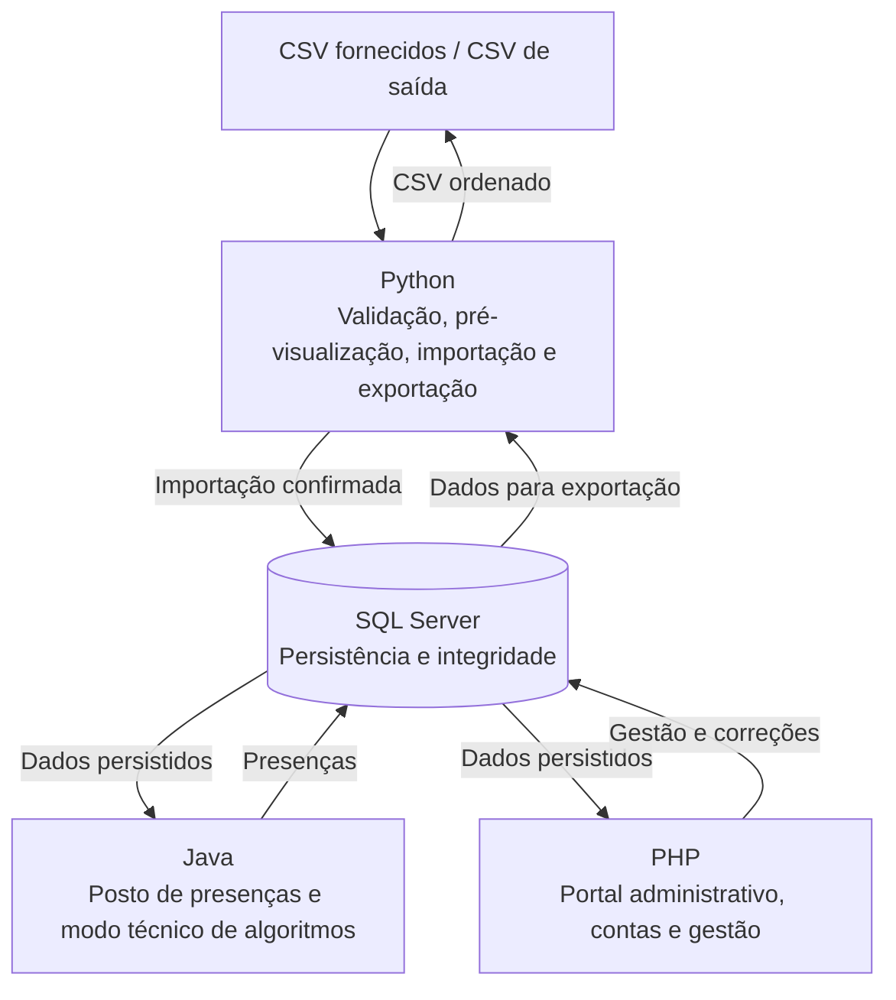

# Sistema de Gestão de Presenças de Docentes

> **Unidade curricular:** Linguagens e Teoria da Computação (LTC)  
> **Ano letivo:** 2026/2027  
> **Curso:** Licenciatura em Engenharia Informática — 2.º ano, 1.º semestre  
> **Docente:** Jaime Manuel Pinheiro de Sousa  
> **Prazo de entrega:** 14 de janeiro de 2027, às 23h59 (hora de Portugal continental)  
> **Defesa:** data a definir pelo ISPGAYA

Este repositório contém o desenvolvimento do trabalho prático de LTC: um sistema para gerir e registar a presença de docentes nas aulas, integrando **Java, PHP, Python e Microsoft SQL Server**.

---

## Índice

- [1. Objetivo do projeto](#1-objetivo-do-projeto)
- [2. Âmbito](#2-âmbito)
- [3. Arquitetura geral](#3-arquitetura-geral)
- [4. Responsabilidades de cada tecnologia](#4-responsabilidades-de-cada-tecnologia)
- [5. Dados e ficheiros fornecidos](#5-dados-e-ficheiros-fornecidos)
- [6. Modelo de dados previsto](#6-modelo-de-dados-previsto)
- [7. Regras funcionais e técnicas](#7-regras-funcionais-e-técnicas)
- [8. Plano de desenvolvimento](#8-plano-de-desenvolvimento)
- [9. Algoritmos e estruturas de dados obrigatórios](#9-algoritmos-e-estruturas-de-dados-obrigatórios)
- [10. Testes e avaliação de desempenho](#10-testes-e-avaliação-de-desempenho)
- [11. Relatório](#11-relatório)
- [12. Estrutura final do ZIP](#12-estrutura-final-do-zip)
- [13. Plano temporal](#13-plano-temporal)
- [14. Demonstração](#14-demonstração)
- [15. Critérios de avaliação](#15-critérios-de-avaliação)
- [16. Checklist geral](#16-checklist-geral)
- [17. Decisões técnicas a registar](#17-decisões-técnicas-a-registar)

---

## 1. Objetivo do projeto

Desenvolver um sistema que permita registar a presença dos docentes nas aulas.

O cenário principal é o seguinte:

1. O docente desloca-se ao posto junto da segurança.
2. Autentica-se na aplicação Java com o número mecanográfico e a palavra-passe.
3. O sistema apresenta as aulas para as quais o docente pode registar presença.
4. O docente escolhe uma aula e confirma a presença.
5. A presença fica guardada na base de dados SQL Server.
6. A administração utiliza o portal PHP para gerir o planeamento, as contas, as aulas e as presenças.
7. O Python prepara a entrada e a saída de dados através de ficheiros CSV.

O objetivo não é apenas construir as aplicações: é também demonstrar a aplicação de algoritmos e estruturas de dados estudados na unidade curricular, bem como testar e analisar o seu comportamento.

## 2. Âmbito

### Incluído

- Gestão de docentes, disciplinas, turmas e salas.
- Gestão de atribuições, horários e aulas.
- Ativação e reposição de palavras-passe.
- Registo de presenças no posto Java.
- Gestão administrativa de presenças no portal PHP.
- Histórico de alterações e respetivos motivos.
- Importação e exportação de CSV através de Python.
- Implementação própria de algoritmos de pesquisa e ordenação.
- Implementação própria das estruturas de dados exigidas.
- Testes funcionais, medições de desempenho, relatório e documentação de instalação.

### Fora do âmbito

O enunciado limita o projeto ao registo de presenças de docentes. Não exige:

- Gestão de estudantes.
- Gestão de salários.
- Reconhecimento facial.
- Geolocalização.
- Aplicação móvel.
- Publicação do sistema na Internet.

## 3. Arquitetura geral

As quatro componentes partilham a mesma base de dados. O Python importa os dados iniciais e exporta dados já persistidos; Java e PHP consultam e alteram os dados de acordo com as respetivas responsabilidades.



### Princípios de integração

- Java, PHP e Python devem utilizar a mesma base de dados.
- A estrutura da base de dados e os formatos CSV devem ser acordados antes do desenvolvimento paralelo.
- As aplicações devem utilizar consultas SQL parametrizadas.
- A configuração de ligação deve ficar fora do código e do repositório; não devem ser incluídas credenciais reais.
- O SQL pode ser utilizado para consultar, relacionar e persistir dados (`SELECT`, `WHERE`, `JOIN`, `INSERT`, `UPDATE`, `DELETE`), bem como para garantir integridade e transações.
- As pesquisas, ordenações, regras de negócio e cálculos avaliados devem ser executados no código das aplicações, em memória. Não devem ser substituídos por `ORDER BY`, `GROUP BY`, `DISTINCT`, funções de ranking, agregações ou lógica em triggers/procedimentos SQL.

## 4. Responsabilidades de cada tecnologia

| Tecnologia | Responsabilidade | Funcionalidades principais |
|---|---|---|
| **SQL Server** | Persistência | Tabelas, relações, chaves, restrições, integridade e transações. |
| **Python** | Entrada e saída de dados | Validar CSV, pré-visualizar, importar, ordenar e exportar. |
| **Java** | Posto e matéria de LTC | Autenticar docentes, registar presenças e implementar algoritmos/estruturas. |
| **PHP** | Administração | Gerir dados, contas, horários, aulas, presenças, histórico e indicadores. |

### 4.1. SQL Server

- Criar a base de dados e todas as tabelas necessárias.
- Definir chaves primárias e estrangeiras.
- Definir restrições de unicidade e integridade.
- Garantir as regras de unicidade de atribuições, aulas e presenças.
- Utilizar transações nas operações que o exijam.
- Disponibilizar uma referência temporal do próprio SQL Server para as verificações de horário.

### 4.2. Python — importação

O programa de importação deve disponibilizar operações distintas para **pré-visualizar** e **importar**.

A pré-visualização não pode alterar a base de dados. A importação só pode ocorrer depois de confirmação explícita, deve revalidar a situação atual e deve inserir os candidatos numa transação.

### 4.3. Python — exportação

O programa de exportação deve:

- Ler os dados necessários sem depender de uma ordenação feita pelo SQL.
- Construir uma coleção em memória.
- Ordenar com HeapSort ou Insertion Sort implementados pelo grupo.
- Escrever um novo CSV sem alterar a base de dados.
- Apresentar o tipo de dados, algoritmo, chave e número de linhas exportadas.

### 4.4. Java — posto de presenças

A aplicação pública do posto deve permitir ao docente autenticar-se, consultar as aulas elegíveis, selecionar uma aula, confirmar a presença e terminar a sessão. A presença só é criada depois da confirmação e de uma nova validação das regras.

### 4.5. Java — modo técnico

Deve existir um modo separado do posto público para carregar conjuntos de dados, pesquisar, ordenar, trabalhar com estruturas de dados, excluir e restaurar registos em memória e exportar seleções.

### 4.6. PHP — portal administrativo

O portal deve ser reservado a administradores autenticados, com exceção da página de ativação através de ligação individual. Deve gerir os dados do sistema e permitir consultar e corrigir presenças, mantendo o histórico.

## 5. Dados e ficheiros fornecidos

O enunciado identifica três pastas dentro de `Ficheiros_Apoio`.

| Pasta | Utilização |
|---|---|
| `Dados_Base` | Dados iniciais a importar com Python. |
| `Dados_Algoritmos` | Conjuntos para pesquisas, ordenações, ensaios, validação de erros e testes de exportação. |
| `Modelos_Importacao` | Templates para confirmar os cabeçalhos e criar ficheiros de teste; inclui ficheiros estruturalmente inválidos. |

### 5.1. Ficheiros de dados base

| Ficheiro | Conteúdo |
|---|---|
| `docentes.csv` | Número mecanográfico, nome, email e estado ativo/inativo. Não contém palavras-passe. |
| `disciplinas.csv` | Disciplinas, ano curricular e semestre. |
| `turmas.csv` | Identificação das turmas, curso e ano. |
| `salas.csv` | Identificação das salas, edifício e capacidade. |
| `atribuicoes.csv` | Associação de cada docente à disciplina e turma que leciona. |
| `horarios.csv` | Planeamento semanal, horas, sala e período de vigência de uma atribuição. |
| `aulas.csv` | Sessões concretas de um horário numa data, inicialmente `PREVISTA` ou `CANCELADA`. |

Um **horário** representa uma repetição semanal. Uma **aula** representa uma ocorrência concreta desse horário numa determinada data.

### 5.2. Quantidades esperadas na base inicial

Os dados base contêm informação de 9 de novembro de 2026 a 1 de março de 2027.

| Tipo de registo | Total esperado |
|---|---:|
| Docentes | 12 |
| Disciplinas | 6 |
| Turmas | 4 |
| Salas | 4 |
| Atribuições | 12 |
| Horários | 24 |
| Aulas | 388 |

O calendário é fictício e não modela feriados ou interrupções letivas.

### 5.3. Ficheiros para testar a importação

Depois de importar os dados base, o ficheiro `docentes_135_com_erros.csv` deverá apresentar:

- 100 candidatos;
- 20 linhas inválidas;
- 10 duplicados no ficheiro;
- 5 duplicados na base de dados.

O ficheiro `horarios_6_com_erros.csv` deverá apresentar:

- 1 candidato;
- 3 linhas inválidas;
- 1 duplicado no ficheiro;
- 1 duplicado na base de dados.

Os resultados devem ser comparados com os respetivos ficheiros `ocorrencias_esperadas_....csv`. Estes ficheiros de resultados esperados servem para comparação e **não devem ser importados**.

## 6. Modelo de dados previsto

O modelo relacional deve incluir, pelo menos, as seguintes entidades:

| Entidade | Informação/responsabilidade |
|---|---|
| `Docentes` | Número mecanográfico, nome, email e estado. |
| `Disciplinas` | Código, designação, ano e semestre. |
| `Turmas` | Código, curso e ano. |
| `Salas` | Código, edifício e capacidade. |
| `Atribuicoes` | Relação entre docente, disciplina e turma. |
| `Horarios` | Atribuição, dia da semana, horas, sala e vigência. |
| `Aulas` | Ocorrência concreta de um horário numa data e respetivo estado. |
| `Contas` | Informação necessária à autenticação do docente. |
| `Presencas` | Docente, aula, instante, estado, origem e motivo. |
| `HistoricoAlteracoes` | Valor anterior, valor novo, motivo, autor e instante. |
| `AtivacoesConta` | Informação segura para validar códigos de ativação, validade e utilização. |

### Restrições importantes

- Um docente por atribuição turma–disciplina.
- Uma ocorrência por par horário–data.
- Um único registo de presença por docente–aula.
- A presença tem de corresponder ao docente responsável pela aula.
- Os códigos externos dos CSV têm de ser preservados, mesmo que o grupo escolha chaves internas próprias.
- O número mecanográfico é texto com seis algarismos, preservando zeros iniciais.
- Os instantes são guardados em UTC e apresentados na zona `Europe/Lisbon`.

## 7. Regras funcionais e técnicas

### 7.1. Validação de campos

Aplicar as regras seguintes nas importações e nas aplicações:

- Nome, curso e edifício: entre 2 e 120 caracteres.
- Email: obrigatório, único, até 254 caracteres, sem espaços, com uma única `@` e domínio `ispgaya.pt`.
- Códigos: entre 1 e 20 caracteres; apenas letras ASCII, algarismos, hífen ou underscore; normalizados para maiúsculas.
- Estado `ativo`: `0` ou `1`.
- Ano: `1` a `3`.
- Semestre: `1` ou `2`.
- Capacidade: inteiro positivo.
- Datas: formato `YYYY-MM-DD`.
- Horas: formato `HH:MM`.
- A hora de início tem de ser anterior à hora de fim, no mesmo dia.
- Dia semanal: `1` (segunda-feira) a `7` (domingo).
- O período de vigência é inclusivo e deve conter uma ocorrência do dia semanal indicado.
- O ano da turma deve coincidir com o ano da disciplina.
- Um horário tem de referenciar uma atribuição e uma sala existentes.
- Uma aula tem de referenciar um horário e uma data compatíveis com o dia semanal e o período de vigência.

### 7.2. Importação CSV

- Codificação UTF-8, com ou sem BOM.
- Separador ponto e vírgula (`;`).
- Suporte de campos entre aspas duplas quando contêm o separador.
- Utilizar uma biblioteca CSV; não separar linhas simplesmente com `split(';')`.
- Validar a estrutura de todo o ficheiro antes de escrever na base de dados.
- O cabeçalho tem de ser exato e respeitar os nomes e a ordem esperados.
- Não aceitar quebras de linha dentro dos campos.
- Ignorar linhas físicas vazias, mantendo o número original da linha.
- Remover espaços exteriores, normalizar códigos para maiúsculas e emails para minúsculas.
- A primeira falha encontrada na ordem do cabeçalho determina o motivo da linha inválida.
- Distinguir `INVALIDO`, `DUPLICADO_FICHEIRO`, `DUPLICADO_BD` e `CANDIDATO` na pré-visualização.
- Após confirmação e inserção bem-sucedida, distinguir os registos como `INSERIDO`.
- Não atualizar fichas existentes durante uma importação.
- Em caso de falha técnica durante a operação, reverter todas as inserções dessa execução.

Um template que contenha apenas o cabeçalho é válido e processa zero linhas. Ficheiros vazios (zero bytes), com cabeçalho ou separador incorretos, sintaxe inválida ou campos a mais/a menos são erros estruturais e impedem qualquer escrita.

No sucesso, deve verificar-se:

```text
total = inseridos + inválidos + duplicados_no_ficheiro + duplicados_na_base_de_dados
```

### 7.3. Deteção de conflitos de horários

Ao validar horários, verificar conflitos com os dados existentes na base e com os candidatos anteriormente aceites no mesmo ficheiro.

Uma sobreposição não pode ocupar o mesmo:

1. docente;
2. turma;
3. sala.

Esta é também a ordem de prioridade dos motivos de erro. Intervalos consecutivos não colidem. Deve existir uma data de ocorrência comum para o conflito ser relevante.

### 7.4. Ativação e reposição de palavras-passe

- A importação de um docente não cria uma palavra-passe.
- O primeiro administrador deve ser criado através de um procedimento PHP documentado.
- O administrador pode solicitar a ativação de um docente ativo.
- A ligação tem um código aleatório, individual, de utilização única e validade de 30 minutos.
- A mensagem aparece numa caixa de correio simulada dentro do portal; não é enviado email real.
- A mensagem não pode conter uma palavra-passe.
- A palavra-passe deve ter pelo menos oito caracteres e os dois campos de confirmação têm de coincidir.
- Ligações inválidas, expiradas ou já utilizadas são recusadas.
- Guardar apenas um valor de verificação seguro da palavra-passe, com salt e parâmetros documentados; nunca guardar texto simples.
- Java e PHP têm de utilizar mecanismos/formato compatíveis para verificar a mesma palavra-passe.
- Ao iniciar uma reposição, invalidar ligações anteriores ainda não utilizadas. A palavra-passe anterior mantém-se até a nova ser confirmada.
- Docentes inativos ou ainda sem palavra-passe definida não podem autenticar-se no posto.
- A ativação não concede acesso ao painel administrativo.
- Não exportar palavras-passe, hashes, códigos ou ligações de ativação.

### 7.5. Registo de presenças em Java

O docente introduz o número mecanográfico e a palavra-passe. A aplicação verifica a conta, a palavra-passe e o estado ativo. A autenticação, por si só, não regista presença.

Uma aula só é elegível quando:

- Está no estado `PREVISTA`.
- O instante atual pertence ao intervalo `[início - 15 minutos, fim)`.
- A aula pertence ao docente autenticado.

O instante de referência para as verificações temporais deve ser obtido do SQL Server, não do relógio do computador cliente.

A lista de aulas elegíveis deve ser ordenada em memória por data, hora de início e código, com um algoritmo próprio. Se houver várias aulas elegíveis, o docente tem de escolher uma.

Antes de gravar, o Java deve revalidar identidade, atribuição, estado da aula e intervalo temporal. Deve criar um único registo de presença com estado `REGISTADA`, instante e origem `JAVA`.

Se já existir uma presença, apresentar o registo existente sem duplicar nem alterar o instante original. Se estiver `ANULADA`, não a recriar no posto; a correção é administrativa. Registar presença não altera automaticamente o estado da aula para `REALIZADA`.

#### Exemplo de janela temporal

Para uma aula das 10:00 às 11:30:

| Instante | Resultado |
|---|---|
| 09:44 | Recusado |
| 09:45 | Aceite |
| 10:00 | Aceite |
| 11:29 | Aceite |
| 11:30 | Recusado |

A sessão do posto deve permitir cancelamento e terminar após 30 segundos de inatividade, limpando os dados do docente anterior. Nunca registar palavras-passe em logs.

### 7.6. Administração em PHP

O painel administrativo deve permitir:

**Gestão de dados**
- Criar, consultar e atualizar docentes, disciplinas, turmas e salas.
- Inativar docentes sem apagar o histórico.
- Eliminar fisicamente apenas fichas sem referências; caso contrário, explicar a recusa.
- Criar e gerir atribuições e horários, validando conflitos de docente, turma e sala.
- Só alterar ou eliminar atribuições e horários sem ocorrências de aula associadas. Quando já existirem ocorrências, preservar o histórico e criar novo planeamento quando necessário.

**Gestão de aulas**
- Criar ocorrências para um horário e data válidos, no estado inicial `PREVISTA`.
- Impedir duplicação do par horário–data.
- Alterar a data apenas se a aula for futura, estiver `PREVISTA` e não tiver presença.
- Marcar como `REALIZADA` apenas depois da hora final.
- Cancelar aulas `PREVISTA`, exigindo motivo e passando-as a `CANCELADA`.
- Preservar presenças existentes e histórico; aulas canceladas não entram nos indicadores.

**Gestão de presenças**
- Consultar por docente, disciplina, turma e datas.
- Criar registos manuais, anular e repor presenças, sempre com motivo.
- Um registo manual só pode referir o docente responsável e uma aula já iniciada e não cancelada.
- Identificar origem `ADMINISTRACAO`, instante de presença declarado, autor e instante real de gravação.
- Não alterar o docente/aula de uma presença existente: anular o registo errado e criar o correto, com justificação.
- Guardar histórico com valor anterior, valor novo, motivo, autor e instante.

### 7.7. Indicadores

Os indicadores são calculados em código, por docente:

```text
percentagem = 100 * presencas_registadas / aulas_realizadas
faltas = aulas_realizadas - presencas_registadas
```

Regras:

- Contar apenas aulas `REALIZADA`.
- Contar apenas presenças `REGISTADA` nessas aulas.
- Não contar aulas `PREVISTA` ou `CANCELADA`.
- Não contar presenças `ANULADA`.
- Sem aulas realizadas, apresentar `Sem dados`.
- Arredondar a apresentação a duas casas decimais.
- Não criar automaticamente um registo de presença para representar uma falta.

Exemplo de validação: duas aulas realizadas e uma presença válida devem produzir `50,00%`.

## 8. Plano de desenvolvimento

A sequência abaixo segue as etapas do enunciado e define o resultado esperado antes de avançar.

### Etapa 1 — Preparar a base de dados

**Tarefas**

- [ ] Analisar os sete CSV base e os templates correspondentes.
- [ ] Desenhar o modelo relacional.
- [ ] Definir tabelas, chaves primárias, chaves estrangeiras e restrições de unicidade.
- [ ] Incluir contas, presenças, histórico e ativações de conta.
- [ ] Preservar os códigos externos dos CSV.
- [ ] Implementar os scripts de criação da base de dados e da estrutura.
- [ ] Testar a criação numa base vazia.
- [ ] Confirmar a ligação das aplicações à mesma base de dados.

**Resultado esperado:** estrutura vazia criada e pronta para receber os dados.

### Etapa 2 — Validar e importar CSV com Python

**Tarefas**

- [ ] Implementar leitura CSV em UTF-8 com ou sem BOM.
- [ ] Validar cabeçalho, codificação, sintaxe e número de campos antes de escrever.
- [ ] Preservar o número original das linhas.
- [ ] Validar campos e referências pela ordem do cabeçalho.
- [ ] Normalizar códigos e emails.
- [ ] Detetar duplicados no ficheiro e na base de dados.
- [ ] Validar regras de negócio e conflitos de horários.
- [ ] Apresentar pré-visualização com linha, dados, estado e motivo.
- [ ] Implementar confirmação explícita para importar.
- [ ] Revalidar antes de inserir e utilizar transação.
- [ ] Guardar ocorrências CSV/JSON.
- [ ] Testar a ordem de importação: docentes, disciplinas, turmas, salas, atribuições, horários e aulas.
- [ ] Confirmar os totais esperados e o comportamento da reimportação.

**Resultado esperado:** dados base importados corretamente; pré-visualização sem escrita; importação transacional e resultados de erro comparáveis aos ficheiros esperados.

### Etapa 3 — Ativar contas e definir palavras-passe em PHP

**Tarefas**

- [ ] Criar o procedimento de instalação do primeiro administrador.
- [ ] Proteger o painel e a caixa de correio simulada com autenticação administrativa.
- [ ] Criar a ação «Enviar ativação» para docentes ativos.
- [ ] Gerar código individual, aleatório, de utilização única e com validade de 30 minutos.
- [ ] Criar a caixa de correio simulada.
- [ ] Criar a página de ativação e validação da palavra-passe.
- [ ] Guardar apenas o hash seguro da palavra-passe.
- [ ] Implementar utilização única, expiração e invalidação de ligações anteriores.
- [ ] Implementar reposição de acesso.
- [ ] Garantir compatibilidade de verificação de palavra-passe com Java.
- [ ] Documentar o procedimento em `INSTRUCOES.txt`.

**Resultado esperado:** a conta só permite autenticação Java depois da ativação PHP; a reposição faz com que apenas a nova palavra-passe funcione após confirmação.

### Etapa 4 — Registar presenças em Java

**Tarefas**

- [ ] Criar o ecrã de autenticação do posto.
- [ ] Verificar credenciais, ativação e estado do docente.
- [ ] Obter as aulas atribuídas ao docente.
- [ ] Filtrar aulas `PREVISTA` dentro da janela temporal permitida.
- [ ] Obter o instante de referência do SQL Server.
- [ ] Ordenar as aulas em memória por data, início e código.
- [ ] Apresentar os dados necessários e a indicação de presença já registada.
- [ ] Exigir a escolha da aula e a confirmação da presença.
- [ ] Revalidar as regras imediatamente antes da gravação.
- [ ] Impedir duplicações e preservar o instante do registo existente.
- [ ] Apresentar mensagens claras para erros e situações sem aulas elegíveis.
- [ ] Implementar cancelamento e timeout de inatividade de 30 segundos.
- [ ] Limpar a sessão e os dados do docente anterior.
- [ ] Confirmar no PHP que a presença gravada em Java fica visível.

**Resultado esperado:** o docente regista uma única presença válida e o registo fica disponível no portal PHP.

### Etapa 5 — Implementar algoritmos e estruturas de dados em Java

**Tarefas**

- [ ] Criar um modo técnico separado do posto público.
- [ ] Abrir CSV ou carregar dados persistidos para memória.
- [ ] Apresentar o conjunto completo, com paginação se necessário.
- [ ] Implementar pesquisa sequencial e binária.
- [ ] Implementar Bubble Sort, Selection Sort e Insertion Sort.
- [ ] Implementar max-heap e HeapSort.
- [ ] Implementar lista simplesmente ligada com nós próprios.
- [ ] Implementar pilha LIFO para desfazer exclusões.
- [ ] Implementar fila FIFO para gerir a exportação.
- [ ] Implementar tabela hash com encadeamento.
- [ ] Implementar tabela hash com sondagem linear.
- [ ] Implementar árvore binária de pesquisa.
- [ ] Mostrar algoritmo, chave, quantidade de dados e comparações.
- [ ] Desativar pesquisa binária quando o vetor não estiver ordenado pela mesma chave.
- [ ] Permitir excluir apenas da seleção em memória e desfazer a última exclusão.
- [ ] Exportar a seleção para um novo CSV sem alterar a origem ou a base de dados.

**Resultado esperado:** algoritmos e estruturas obrigatórios implementados e demonstráveis com os conjuntos fornecidos.

### Etapa 6 — Desenvolver a gestão administrativa em PHP

**Tarefas**

- [ ] Criar autenticação e controlo de acesso administrativo.
- [ ] Implementar CRUD de docentes, disciplinas, turmas e salas, com validações.
- [ ] Implementar inativação de docentes e regras de eliminação física.
- [ ] Gerir atribuições e horários com validação de conflitos.
- [ ] Impedir alterações incompatíveis com ocorrências de aulas já existentes.
- [ ] Criar e gerir aulas concretas.
- [ ] Implementar estados `PREVISTA`, `REALIZADA` e `CANCELADA`.
- [ ] Consultar presenças por docente, disciplina, turma e datas.
- [ ] Implementar registos manuais, anulações e reposições com motivo.
- [ ] Guardar o histórico de alterações.
- [ ] Implementar os indicadores por docente em código.
- [ ] Testar o caso de duas aulas realizadas e uma presença (50,00%).

**Resultado esperado:** administração funcional, correções justificadas e histórico preservado.

### Etapa 7 — Exportar dados com Python

**Tarefas**

- [ ] Implementar HeapSort em Python.
- [ ] Implementar Insertion Sort em Python.
- [ ] Obter os dados sem `ORDER BY`.
- [ ] Construir a coleção em memória.
- [ ] Permitir escolher tipo de dados, destino, chave e algoritmo.
- [ ] Ordenar em memória e escrever um novo CSV.
- [ ] Apresentar tipo, algoritmo, chave e número de linhas.
- [ ] Não alterar a base de dados.
- [ ] Excluir dados de autenticação e ativação das exportações.

**Ordenações e cabeçalhos previstos**

| Exportação | Ordenação |
|---|---|
| Docentes | Número ou nome sem distinguir maiúsculas; número como desempate. Cabeçalho: `numero_mecanografico;nome;email;ativo`. |
| Horários | Dia semanal numérico, hora inicial e código. Utilizar o cabeçalho do CSV de importação de horários. |
| Aulas | Data, hora inicial e código. Cabeçalho: `codigo_aula;codigo_horario;numero_mecanografico;codigo_disciplina;codigo_turma;codigo_sala;data_aula;hora_inicio;hora_fim;estado`. |
| Presenças | Instante, número e código da aula. Cabeçalho: `numero_mecanografico;codigo_aula;instante_presenca_utc;estado;origem;motivo`. |

Na exportação de presenças, o instante deve estar em UTC, em ISO 8601, com sufixo `Z`. A exportação enriquecida de aulas não corresponde ao formato de importação de `aulas.csv`. Não existe importação de presenças.

**Resultado esperado:** exportações CSV ordenadas com algoritmos próprios, sem alterações à base de dados.

### Etapa 8 — Testar e comparar resultados

**Tarefas**

- [ ] Criar casos de teste com preparação, entrada/ação, esperado, observado e evidência.
- [ ] Testar ativação, reposição e ligações inválidas, expiradas ou reutilizadas.
- [ ] Testar permissões, docentes inativos e timeout do posto.
- [ ] Testar os limites temporais da presença.
- [ ] Testar aulas de outros docentes, realizadas ou canceladas.
- [ ] Testar duplicações e conflitos de horários.
- [ ] Testar histórico e correções administrativas.
- [ ] Testar indicadores e exclusões de aulas canceladas/presenças anuladas.
- [ ] Testar importação, erros estruturais, cancelamento e rollback.
- [ ] Testar algoritmos e integração entre Java, PHP, Python e SQL Server.
- [ ] Guardar resultados brutos, medições, ocorrências e capturas de ecrã.

**Resultado esperado:** evidências reproduzíveis de que as regras e funcionalidades estão corretas.

### Etapa 9 — Elaborar o relatório

**Tarefas**

- [ ] Apresentar problema, objetivos e âmbito.
- [ ] Explicar arquitetura e modelo de dados.
- [ ] Descrever importação, ativação, registo Java, administração PHP e exportação.
- [ ] Explicar estados, horários, permissões e histórico.
- [ ] Descrever algoritmos e estruturas, com métodos/ficheiros relevantes.
- [ ] Incluir exemplos de pesquisa binária, colisão e heap.
- [ ] Justificar complexidade temporal e memória auxiliar.
- [ ] Apresentar metodologia, equipamento, versões, dados, repetições e resultados.
- [ ] Incluir tabelas/gráficos e discutir os resultados sem inventar medições.
- [ ] Explicar testes, falhas, limitações e soluções.
- [ ] Identificar contributos individuais, fontes, bibliotecas e ferramentas de IA utilizadas.
- [ ] Incluir capturas reais numeradas, legendadas e comentadas.

O enunciado pede um relatório original em PDF, com mínimo de 10 a 15 páginas de corpo, excluindo capa, referências e anexos. Como objetivo de planeamento, recomenda-se apontar para cerca de 15 páginas de conteúdo, sem substituir a interpretação oficial do enunciado.

**Resultado esperado:** relatório PDF completo, fundamentado no trabalho efetivamente desenvolvido e nos resultados obtidos.

### Etapa 10 — Preparar a entrega executável

**Tarefas**

- [ ] Gerar `PresencasDocentes.jar` com classe principal e dependências necessárias, incluindo controlador JDBC.
- [ ] Disponibilizar `iniciar.bat` e runtime compatível com Windows de 64 bits.
- [ ] Incluir todo o código-fonte Java, PHP e Python.
- [ ] Incluir scripts SQL para reconstruir a base de dados numa instalação vazia.
- [ ] Incluir CSV de demonstração, testes, ocorrências, exportações, evidências e medições.
- [ ] Incluir relatório PDF e materiais de apresentação.
- [ ] Criar `INSTRUCOES.txt` com instalação, configuração, utilização, compilação e testes.
- [ ] Testar o ZIP fora do ambiente de desenvolvimento.
- [ ] Confirmar que não existem credenciais reais, segredos ou ficheiros temporários.

**Resultado esperado:** um único ZIP que permite instalar, executar, testar e reconstruir o projeto num ambiente externo.

## 9. Algoritmos e estruturas de dados obrigatórios

A implementação própria destes algoritmos e estruturas é central para o trabalho. Não substituir por coleções ou algoritmos equivalentes das bibliotecas Java.

### 9.1. Java — algoritmos

| Matéria | Implementação e utilização |
|---|---|
| Pesquisa sequencial | Localizar docentes pelo número e aulas pelo código. |
| Pesquisa binária | Pesquisar num vetor previamente ordenado pela mesma chave. |
| Bubble Sort | Implementar e comparar a ordenação. |
| Selection Sort | Implementar e comparar a ordenação. |
| Insertion Sort | Implementar e comparar a ordenação. |
| Heap / HeapSort | Construir max-heap em vetor e ordenar; demonstrar a representação em vetor e árvore binária completa. |

### 9.2. Java — estruturas de dados

| Estrutura | Operações/requisitos |
|---|---|
| Vetores e registos | Representar dados e criar cópias equivalentes para os ensaios. |
| Lista simplesmente ligada | Inserir, procurar, remover e percorrer, utilizando nós próprios; reutilizar nos buckets da dispersão. |
| Pilha LIFO | Guardar exclusões e desfazer a última; ao restaurar, reaplicar a ordenação ativa, se existir. |
| Fila FIFO | Inserir, remover, consultar a frente e testar vazio; reconstruir a fila em cada nova exportação. |
| Dispersão com encadeamento | Índice por número de docente, função de dispersão, inserção, pesquisa, remoção, colisões e fator de carga. |
| Dispersão com sondagem linear | Percurso circular, marcador de eliminado e deteção de tabela cheia. |
| Árvore binária de pesquisa | Inserir, pesquisar e listar por ordem; explicar a influência da altura. Não é exigido balanceamento nem remoção. |

### 9.3. Restrições sobre bibliotecas

Não utilizar como substitutos das implementações próprias:

- `LinkedList`
- `HashMap`
- `TreeMap`
- `PriorityQueue`
- `Arrays.sort()`
- `Collections.sort()`
- Métodos ou estruturas equivalentes

As bibliotecas podem ser utilizadas para leitura de CSV/JSON, construção de interfaces e acesso à base de dados. Os algoritmos devem atuar sobre todos os dados selecionados, não apenas sobre a página visível.

### 9.4. Python — ordenação

Implementar os dois algoritmos exigidos para exportação:

- HeapSort.
- Insertion Sort.

Não utilizar `sorted()` nem `list.sort()`.

## 10. Testes e avaliação de desempenho

### 10.1. Conjuntos de dados

Executar ensaios com:

- 100 registos;
- 1 000 registos;
- 10 000 registos.

Para 1 000 registos, comparar as variantes desordenada, ordenada e em ordem inversa. As variantes representam as mesmas pessoas. Comparar as variantes antes de importar ou repor a base de teste entre ensaios.

### 10.2. Procedimento de medição

- Comparar as quatro ordenações Java e as duas ordenações Python.
- Utilizar cópias equivalentes dos mesmos dados antes de cada execução.
- Em Java, realizar pelo menos cinco aquecimentos e dez repetições medidas por cenário.
- Documentar um procedimento equivalente em Python.
- Para pesquisas rápidas, medir lotes de pelo menos 1 000 consultas.
- Medir apenas o algoritmo em memória, excluindo SQL, ficheiros, cópias e interface.
- Guardar tempos brutos, unidades, operações e comparações.
- Apresentar mediana e intervalo interquartil e indicar o método dos quartis utilizado.
- Justificar tempo e memória auxiliar, distinguindo preparação/consulta e melhor/pior/esperado.
- Discutir diferenças observadas e limites da comparação entre linguagens.
- Relacionar os resultados com crescimento polinomial/exponencial e NP-completude, conforme pedido no enunciado.

**Não inventar medições.** Os resultados apresentados no relatório devem corresponder a ensaios realmente executados.

### 10.3. Matriz mínima de testes funcionais

| Área | Casos a validar |
|---|---|
| Ativação/reposição | Antes e depois da ativação; ligação expirada/usada; após reposição só a nova palavra-passe funciona. |
| Email simulado | Mensagem com destinatário e ligação; sem envio real e sem palavra-passe no conteúdo. |
| Permissões/sessão | Sem administrador não há gestão; docente inativo é recusado; posto limpa a sessão. |
| Horário/presença | Início menos 15 minutos é aceite; hora de fim é recusada; aulas alheias, realizadas ou canceladas são recusadas; repetição não duplica. |
| Planeamento/histórico | Conflitos e horário–data duplicado são recusados; intervalos consecutivos são aceites; correções exigem motivo e preservam histórico. |
| Indicadores | Sem aulas realizadas: `Sem dados`; uma presença em duas aulas realizadas: `50,00%`; anuladas/canceladas são excluídas. |
| Importação | Totais base corretos; erros estruturais não escrevem; cancelamento não escreve; falha técnica reverte a execução. |
| Algoritmos/integração | Pré-visualizar/exportar não altera a base; ordenações preservam os elementos; Java e PHP observam alterações confirmadas. |

## 11. Relatório

O relatório deve apresentar o desenvolvimento real, decisões, testes e resultados. Estrutura recomendada:

1. **Introdução:** problema, objetivos e âmbito.
2. **Arquitetura:** Java, PHP, Python e SQL Server.
3. **Modelo de dados:** diagrama, tabelas, relações, chaves e integridade.
4. **Importação:** formatos, validações, duplicados e regras de negócio.
5. **Autenticação:** ativação, correio simulado e reposição de palavras-passe.
6. **Aplicação Java:** autenticação, elegibilidade e registo de presenças.
7. **Gestão PHP:** administração, aulas, presenças, histórico e indicadores.
8. **Exportação Python:** dados, algoritmos, chaves e formatos CSV.
9. **Algoritmos e estruturas:** funcionamento, utilização e complexidade.
10. **Testes e resultados:** metodologia, medições, tabelas, gráficos e discussão.
11. **Dificuldades e soluções:** limitações, contributos individuais e conclusões.
12. **Referências:** fontes, bibliotecas, ferramentas e utilização de IA.

### Evidências visuais

Incluir capturas reais de:

- Pré-visualização e erros da importação Python.
- Dados antes e depois de ordenar em Java.
- Ativação e mensagem simulada.
- Autenticação e registo de presença em Java.
- Gestão e correções no PHP.
- Indicadores e integração com a base de dados.
- Erros e condições fronteira relevantes.

Cada figura deve ter número, legenda, referência no texto e explicação do que comprova. Utilizar dados fictícios e ocultar segredos. As capturas não substituem os CSV de resultados experimentais nem a explicação do código.

## 12. Estrutura final do ZIP

A entrega deve consistir num único ZIP identificado com o grupo.

```text
Trabalho_LTC_Grupo/
│
├── aplicacao_java/
│   ├── PresencasDocentes.jar
│   ├── iniciar.bat
│   ├── runtime/
│   └── configuracao_exemplo
│
├── codigo_fonte/
│   ├── java/
│   ├── php/
│   └── python/
│
├── base_dados/
│   └── scripts_sql/
│
├── testes_e_resultados/
│   ├── csv/
│   ├── ocorrencias/
│   ├── exportacoes/
│   ├── evidencias/
│   └── medicoes/
│
├── documentacao/
│   ├── relatorio.pdf
│   └── apresentacao/
│
└── INSTRUCOES.txt
```

### Requisitos da aplicação Java distribuída

- O JAR deve ter classe principal definida e todas as dependências necessárias, incluindo o controlador JDBC.
- Deve executar com `java -jar PresencasDocentes.jar`.
- Deve disponibilizar os modos de posto e de trabalho com dados.
- Incluir runtime compatível com Windows de 64 bits.
- O `iniciar.bat` deve executar `runtime\bin\java.exe -jar PresencasDocentes.jar`.
- A ligação à base de dados deve ser configurável externamente, sem recompilar.
- A defesa não deve exigir IDE nem instalação manual de bibliotecas.

### Conteúdo de `INSTRUCOES.txt`

- Requisitos, versões e dependências realmente testadas.
- Ordem de execução dos scripts SQL numa base vazia.
- Configuração das aplicações.
- Criação do primeiro administrador PHP.
- Ativação das contas de demonstração pela caixa simulada.
- Ordem e comandos de importação.
- Comandos/opções para Java, PHP e Python, incluindo algoritmos de exportação.
- Como reconstruir o JAR a partir das fontes.
- Como executar os testes e reproduzir a demonstração, com resultados esperados.

Utilizar caminhos relativos. Não incluir credenciais reais nem ficheiros temporários. Uma cópia de segurança da base de dados não substitui os scripts SQL, e os ficheiros compilados não substituem o código-fonte.

## 13. Plano temporal

O calendário seguinte é uma **proposta de organização** baseada no prazo oficial de 14 de janeiro de 2027.

| Período | Objetivo | Entregável intermédio |
|---|---|---|
| 9–15 novembro | Análise, modelo de dados e arquitetura | Diagrama e decisões técnicas acordadas |
| 16–22 novembro | SQL Server e preparação de Python | Base vazia criada e ligação testada |
| 23–29 novembro | Importação e validação CSV | Dados base importados e ocorrências de teste |
| 30 novembro–6 dezembro | Ativação PHP e autenticação partilhada | Contas de demonstração ativáveis e verificáveis em Java |
| 7–13 dezembro | Posto de presenças Java | Registo de presença funcional |
| 14–20 dezembro | Algoritmos e estruturas Java | Modo técnico funcional |
| 21–27 dezembro | Administração PHP e exportação Python | Funcionalidades principais integradas |
| 28 dezembro–3 janeiro | Integração e testes | Matriz de testes e medições |
| 4–10 janeiro | Relatório e documentação | Relatório PDF e `INSTRUCOES.txt` |
| 11–14 janeiro | Testes finais e empacotamento | ZIP final validado |

As componentes podem ser desenvolvidas em paralelo depois de o grupo acordar o modelo de dados e os formatos de intercâmbio. Não deixar a integração e os testes para o último dia.

## 14. Demonstração

A sequência recomendada para a defesa é:

1. Partir da distribuição entregue, preparar a base de dados e importar os sete ficheiros. Confirmar os totais.
2. Mostrar a mensagem de ativação simulada, definir a palavra-passe em PHP e autenticar o docente no JAR. Demonstrar também uma ligação inválida ou já utilizada.
3. Selecionar uma aula elegível e registar a presença. Repetir para demonstrar que não duplica. No PHP, consultar a presença, fazer uma correção com motivo e consultar o histórico.
4. Abrir um conjunto desordenado em Java, pesquisar, ordenar, excluir/desfazer e exportar. Demonstrar a exportação Python com algoritmo próprio e os ficheiros com erros.
5. Apresentar testes e medições, explicar estruturas e algoritmos e responder às perguntas.

Todos os elementos do grupo devem compreender o sistema e conseguir analisar ou alterar uma pequena parte do trabalho.

## 15. Critérios de avaliação

A classificação do projeto é calculada na escala de 0 a 20 através da fórmula:

```text
P = 0,60 × T + 0,20 × A + 0,20 × R
```

| Componente | Peso no projeto | Critérios internos |
|---|---:|---|
| Trabalho prático (`T`) | 60% | Algoritmos/estruturas e regras técnicas: 45%; funcionalidades Java/PHP: 25%; Python e persistência: 20%; testes e robustez: 10%. |
| Apresentação e defesa (`A`) | 20% | Demonstração funcional: 40%; compreensão e respostas: 40%; clareza, organização e participação: 20%. |
| Relatório (`R`) | 20% | Explicação e decisões: 30%; algoritmos, complexidade e resultados: 30%; testes e capturas explicadas: 25%; estrutura, referências e contributos: 15%. |

Os pesos `60/20/20` são os pesos internos do projeto. A integração na componente prática e na nota global da unidade curricular segue o regime oficial.

### Implicações para a organização do trabalho

- Não concentrar todo o esforço nas interfaces: algoritmos, estruturas e regras técnicas têm grande peso.
- Garantir que o sistema funciona de ponta a ponta e que as quatro componentes estão integradas.
- Guardar evidências e medições durante o desenvolvimento.
- Preparar todos os elementos para explicar as decisões e demonstrar o funcionamento.
- Funcionalidades extra não compensam requisitos obrigatórios em falta.

## 16. Checklist geral

### Base de dados e integração

- [ ] Modelo relacional documentado.
- [ ] Scripts SQL criam a estrutura numa base vazia.
- [ ] Chaves, restrições e integridade verificadas.
- [ ] Java, PHP e Python acedem à mesma base.
- [ ] Configuração externa sem credenciais reais no repositório.

### Python

- [ ] Pré-visualização sem escrita.
- [ ] Validação estrutural e de conteúdo.
- [ ] Deteção de duplicados e conflitos.
- [ ] Confirmação e importação transacional.
- [ ] Ocorrências CSV/JSON guardadas.
- [ ] HeapSort e Insertion Sort próprios na exportação.
- [ ] Exportações com cabeçalhos, chaves e formatos corretos.

### PHP

- [ ] Criação inicial do administrador.
- [ ] Autenticação e proteção do painel.
- [ ] Caixa de correio simulada.
- [ ] Ativação e reposição de palavras-passe.
- [ ] Gestão de catálogos, atribuições, horários e aulas.
- [ ] Gestão de presenças e histórico.
- [ ] Indicadores calculados em código.

### Java

- [ ] Autenticação compatível com a ativação PHP.
- [ ] Elegibilidade temporal baseada no instante SQL Server.
- [ ] Registo único de presença.
- [ ] Sessão com timeout e limpeza de dados.
- [ ] Modo técnico separado.
- [ ] Pesquisas, ordenações e estruturas obrigatórias implementadas.
- [ ] Exclusão, undo e exportação em memória.

### Testes, relatório e entrega

- [ ] Testes funcionais documentados.
- [ ] Ensaios com 100, 1 000 e 10 000 registos.
- [ ] Medições brutas e tratadas guardadas.
- [ ] Capturas reais com legendas e análise.
- [ ] Relatório PDF concluído.
- [ ] `INSTRUCOES.txt` concluído.
- [ ] JAR, runtime e `iniciar.bat` testados.
- [ ] ZIP testado fora do ambiente de desenvolvimento.
- [ ] Todos os elementos preparados para a defesa.

## 17. Decisões técnicas a registar

O enunciado define os requisitos funcionais, mas deixa algumas escolhas técnicas ao grupo. Registar neste repositório as decisões tomadas, para que todos implementem as componentes da mesma forma.

- [ ] Modelo físico da base de dados: nomes definitivos de tabelas, campos e chaves.
- [ ] Tecnologia de acesso à base de dados em Java, PHP e Python e respetivas dependências.
- [ ] Formato exato de armazenamento/validação de palavras-passe compatível entre PHP e Java.
- [ ] Formato de configuração externa para a ligação à base de dados.
- [ ] Organização dos módulos, pacotes, diretórios e nomes dos executáveis.
- [ ] Interface e comandos concretos da importação e exportação Python.
- [ ] Formato dos ficheiros de ocorrências e medições.
- [ ] Versões das ferramentas e dependências efetivamente testadas.

> **Nota:** não preencher estas decisões com valores presumidos. Devem corresponder às escolhas reais do grupo e ser documentadas também em `INSTRUCOES.txt` e no relatório, quando aplicável.

---

## Informação do grupo

| Campo | Preencher |
|---|---|
| Grupo | A definir |
| Elementos | A definir |
| Repositório | A definir |
| Data da última atualização | A definir |

**Prazo oficial:** 14 de janeiro de 2027, às 23h59 (hora de Portugal continental).
